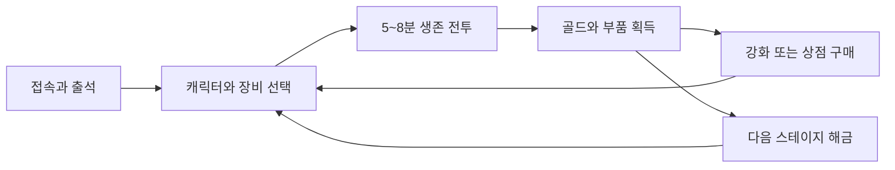

# 게임과 성장 설계

Android 세로 화면에서 한 손으로 움직이며 몰려오는 적을 처치하고, 전투에서 얻은 자원으로 캐릭터와 장비를 키운다. 한 판의 스킬 조합을 만드는 재미와 장기간 성장하는 재미를 연결한다. 명칭·소재·수치는 초기 제안이다.

## 참고할 구조와 차별점

탕탕특공대의 공식 소개에서 확인되는 한 손 조작, 대규모 적 무리, 로그라이크 스킬 조합, 스테이지별 도전을 참고한다. 여기서 제안하는 가격·드롭·성장 수치는 자체 설계다. [탕탕특공대 공식 Google Play 소개](https://play.google.com/store/apps/details?id=com.dxx.firenow&hl=ko)

게임 이름은 **고철 수호대**로 확정했다. 정비사가 폭주한 로봇을 정리하고 부품을 회수한다. 둥근 캐릭터와 선명한 공격 예고를 사용하는 2D 그래픽을 후보로 둔다. 캐릭터, 무기 이름, 아트, UI와 사운드는 독자 제작한다.

차별점은 전투 중 고철 더미에서 드론 부품을 고르는 것이다. 기본 무기와 별도로 드론을 공격형·방어형·수집형 중 하나로 발전시키며, 위험 지역의 고철을 회수할지 안전한 경로로 움직일지 선택한다. 처음에는 드론을 하나만 동반해 제작량과 화면 복잡도를 제한한다.

## 반복 플레이 구조



첫 접속에서는 상점 팝업보다 전투를 먼저 보여준다. 30초 안에 첫 적을 처치하고, 1분 안에 스킬을 고르고, 3분 튜토리얼을 끝낸 후 장비 강화와 두 번째 전투를 경험하게 한다. 출석은 튜토리얼 후 로비에서 안내한다.

일일 기본 루틴은 출석 → 전투 3회 → 강화 → 임무 보상 수령이며 20~30분을 목표로 한다. 매일 접속하지 않아도 누적 출석 진행은 유지한다.

## 전투 규칙

| 항목 | 초기 규칙 |
| --- | --- |
| 이동과 공격 | 드래그 가상 조이스틱, 자동 조준·자동 공격 |
| 한 판 길이 | 튜토리얼 3분, 일반 스테이지 5~8분 |
| 레벨업 | 전투 경험치 획득 후 3개 스킬 중 1개 선택, 선택 중 일시정지 |
| 스킬 슬롯 | 공격 4개와 보조 4개, 각 최대 5레벨 |
| 진화 | 공격 스킬 5레벨과 지정 보조 스킬 3레벨 달성 후 진화 선택지 등장 |
| 보스 | 일반 스테이지는 중간 보스 1회, 마지막 보스 1회 |
| 승리 | 마지막 보스 처치; 보스 등장 후 90초 안에 처치하지 못하면 실패 |
| 실패 | 서버가 인정한 진행 구간에 따른 부분 골드·부품, 최초 클리어 보상은 없음 |
| 재도전 | 초기 버전은 입장 에너지 없음 |
| 부활 | 출시 버전은 없음; 광고 부활은 후속 검토 |

일반전의 전투 레벨과 스킬은 종료하면 초기화한다. 장비, 캐릭터 레벨, 해금, 스테이지 진행은 유지한다. 앱이 백그라운드로 가면 일시정지하며, 프로세스 종료 시 진행 중 전투의 중간 복구는 초기 범위에서 제외하고 안내한다. 전투 보상은 서버에 종료 결과가 확정된 경우에만 지급한다.

첫 스테이지 무기 후보는 리벳건, 회전 톱날, 충격 코일, 화염 분사기, 유도 드론, 자력 폭탄이다. 기본 공격 종류를 나누어 단일 대상·군중 제어·근거리 위험 감수의 선택이 생기게 한다.

## 캐릭터와 능력치

같은 장비를 장착한 레벨 1 기준이며 캐릭터별 강점과 약점이 함께 존재한다. 해금 수단이 달라도 최종 성장 상한은 동일하다.

| 캐릭터 | 공격력 | 체력 | 이동속도 | 고유 능력 | 해금 |
| --- | ---: | ---: | ---: | --- | --- |
| 정비사 | 100 | 1,000 | 5.0 | 드론 피해 +15% | 기본 지급 |
| 돌격수 | 110 | 850 | 5.3 | 치명타 확률 +5%p | 1,200보석 |
| 수호자 | 90 | 1,200 | 4.7 | 20초마다 최대 체력 8% 보호막, 5초 지속 | 누적 출석 7일 |

공통 기본 치명타 확률은 5%, 치명타 배율은 1.5배다. 캐릭터 레벨은 1~30이며 한 레벨마다 기본 공격력과 기본 체력이 각각 최초 값의 3%씩 증가한다. 캐릭터 레벨 강화에는 골드와 공용 부품을 쓴다. 출시 버전에서는 승급·별 등급·중복 캐릭터 조각을 추가하지 않는다.

장비 공격력과 체력을 더한 뒤 전투 내 배율을 적용한다. 스킬마다 피해 계수와 공격 간격을 별도로 정의한다.

```text
영구 공격력 = 캐릭터 기본 공격력 × (1 + 0.03 × (레벨 - 1)) + 장비 공격력 합계
기본 피해 = 영구 공격력 × 스킬 계수 × (1 + 전투 내 피해 증가율 합계)
최종 피해 = max(1, floor(기본 피해 × 치명타 배율 × 적 피해 경감 계수))
최종 이동속도 = 기본 이동속도 × (1 + 이동 증가율 합계), 증가율 상한 30%
```

전투력은 참고 수치만 표시한다. 역할별로 동일 가격대 장비를 맞춰 생존 시간, 군중 처치량, 보스 처치 시간을 비교한다. 특정 유료 해금 캐릭터가 모든 지표에서 우위이면 강점과 약점을 조정한다.

## 장비 성장

초기 슬롯은 무기·갑옷·모듈 3개, 등급은 일반·고급·희귀 3개다. 무기 6종, 갑옷 3종, 모듈 3종으로 기본 장비 정의 12개를 만들고 등급은 공통 규칙으로 표현한다. 희귀도 배율 후보는 1.0 / 1.15 / 1.35다.

무기는 공격 패턴, 갑옷은 체력과 방어적 효과, 모듈은 수집 범위·드론·치명타 등 빌드 방향을 바꾼다. 장비 강화 레벨은 1~20이고, 각 강화는 기본 수치의 5%를 더한다. 고급 장비는 숫자만 올리기보다 빌드 선택을 제공한다.

강화는 항상 성공하며 골드와 부품을 소비한다. 같은 슬롯 장비로 교체할 때 강화 단계를 이전할 수 있게 한다. 이전은 원본을 1레벨로 되돌리고 대상에 단계를 옮기는 단일 거래이며, 이미 강화된 대상에는 초기 버전에서 이전할 수 없다. 강화한 장비는 이전 후 판매하도록 한다.

희귀 장비의 추가 옵션은 장비 정의별 고정값으로 제공한다. 무작위 재련, 유료 옵션 재추첨, 장비 파괴는 첫 출시 이후로 미룬다.

## 출석과 보조 성장

출석은 연속 출석이 아닌 누적 7회 주기다. 서버 기준 한국 시각 오전 5시에 새 일자가 시작되며 기기 시각과 무관하게 처리한다. 보상표는 [재화 설계](02-economy-and-bm.md)에 정의한다.

방치 보상은 전투 재미를 확인한 뒤 넣는 후속 기능이다. 추가한다면 서버가 마지막 수령 시각부터 최대 8시간의 골드·부품을 계산하고 보석은 지급하지 않는다. 방치형 중심으로 변경할 경우 하루 수급표와 강화 비용을 함께 다시 맞춘다.

## 화면 구성

| 화면 | 핵심 정보와 행동 |
| --- | --- |
| 로비 | 선택 캐릭터, 다음 스테이지, 전투 시작, 출석·임무 수령 상태 |
| 캐릭터 | 역할·능력 비교, 해금, 레벨업 |
| 장비 | 장착 비교, 강화, 강화 이전, 잠금, 판매 |
| 상점 | 골드 상점, 보석 상점, 현금 상품; 가격과 확정 구성품 표시 |
| 출석 | 7칸 진행, 오늘 보상, 다음 초기화까지 시간 |
| 전투 | 체력·경험치·시간, 스킬 목록, 일시정지 |
| 결과 | 진행 구간, 확정 보상, 선택형 추가 보상, 재도전 |
| 설정 | 소리·진동·프레임 제한, 계정 연동, 구매 복구, 문의, 계정 삭제 |

하단 탐색은 상점·장비·전투·캐릭터 4개를 기준으로 한다. 출석·임무는 로비에서 진입한다. 보상형 광고는 누르기 전에 정확한 보상과 남은 횟수를 보여준다.

## 콘텐츠 제작 범위

| 단계 | 포함 |
| --- | --- |
| 전투 프로토타입 | 캐릭터 1종, 무기 3종, 적 3종, 보스 1종, 맵 1개 |
| 첫 출시 | 캐릭터 3종, 무기 6종, 일반 적 6종, 보스 3종, 스테이지 5개, 공격·보조 스킬 각 6종 |
| 후속 | 방치 보상, 신규 스테이지, 월간 패스, 시즌 도전, 꾸미기 |

초기에는 PvP, 협동전, 길드, 유저 간 거래, 유료 랜덤 뽑기를 제외한다. 5개 스테이지는 맵과 적 구성을 일부 재사용하되 진행 시간과 공격 패턴을 바꾼다. 캐릭터별 추가 스킨보다 적 공격의 가독성, 피격 반응, 처치 효과, 효과음의 완성도를 먼저 높인다.
