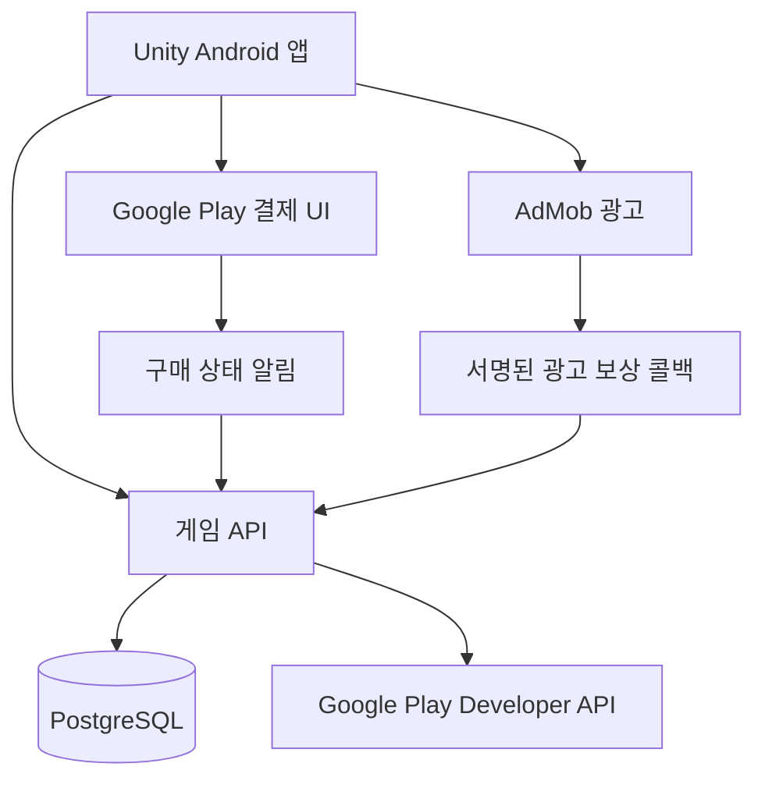

# 서버와 안드로이드 출시 계획

## 0.16 외부 연결 전 서비스 준비

앱 0.16/code 16, 최소 호환 code 14, 전투 규칙 11이다. 일반 구매 코드와 광고 SDK를 추가했지만 실제 Google 계정·공개 서버·광고·판매는 연결하지 않았다. 아래 내용이 과거 버전의 미구현 설명을 대체한다.

### 결제 설정

- `COMMERCE_MODE=disabled|license_test|production`. production은 `COMMERCE_RELEASE_READY=true`가 별도로 필요하다. 잘못된 설정은 시작 시 거절한다.
- `COMMERCE_SALES_ENABLED`는 신규 구매 버튼을 제어한다. 판매 중지 중에도 이미 청구된 구매 검증·복원은 허용한다. Play Console 상품 판매 상태도 함께 관리한다.
- `COMMERCE_DISABLED_PRODUCTS`는 판매에서 제외할 상품 ID 목록이다. 기본 배포에서는 광고 검증 전까지 `ad_skip_lifetime`을 제외한다.
- 테스트/일반 영수증을 상호 거절하며, 테스트 진행 계정은 일반 구매를 사용할 수 없다. 기존 유료/무료 원장·환불·부채 조정은 유지한다.
- `/health/services`는 결제/광고 모드와 환불 조회의 마지막 성공·실패, 연속 실패, 주의 필요 여부를 제공한다. 환불은 시간 단위 폴러다. RTDN 푸시와 장기 중단 복구는 별도 작업이다.

### 광고 설정과 보상 처리

기존 AdMob 계정에 **이 게임을 별도 앱으로 추가하고 새 App ID·보상형 광고 단위를 생성**한다. 다른 앱의 광고 ID는 재사용하지 않는다. [공식 앱 추가](https://support.google.com/admob/answer/9989980?hl=ko).

- SDK는 Google Mobile Ads Unity 11.6.0, Android Ads 25.5.0, UMP 4.0.0으로 고정했다. 설정이 활성화된 Android에서만 앱 시작 시 동의 정보를 갱신하고 `CanRequestAds()` 확인 후 요청한다. 필요한 경우 개인정보 선택 변경 버튼을 제공한다.
- `Assets/Resources/ServiceSettings.json`은 `adsEnabled=false`, `productionAds=false`와 공식 샘플 ID가 기본이다. 실제 App ID·단위 ID·테스트 기기 ID·개인정보/문의/삭제 URL을 설정한다. 빌드 시 App ID를 SDK 설정에 복사한다.
- 서버 `ADS_MODE=disabled|test|production`, `ADMOB_REWARDED_UNIT_ID`. production은 `ADS_RELEASE_READY=true`와 게임 전용 단위를 요구한다. 앱/서버 단위와 모드가 일치해야 표시한다. test 모드의 게임 광고 단위에는 테스트 기기 ID가 필요하다. 샘플 광고 ID로 게임의 SSV를 설정할 수 없으므로 전체 검증은 게임 단위와 등록된 테스트 기기를 사용한다.
- AdMob 콘솔 보상은 **reward / 1**, SSV URL은 `https://운영도메인/v1/ads/ssv`로 설정한다. custom_data는 서버 claim ID, user_id는 공개 계정 ID다. 복구 코드를 보내지 않는다. 실제 골드·부품 지급량은 서버 예약 값으로 결정한다.
- 서버 예약은 동일 계정·보상 종류의 동시 요청을 막는다. 20분 또는 서비스 일자 종료 시 만료한다. 표시 실패·취소는 지급 횟수를 소비하지 않는다. 로컬 시청 완료 콜백은 재화를 지급하지 않는다.
- SSV는 원본 쿼리 ECDSA/SHA256 DER 서명, Google 키(12시간 캐시), 광고 단위·계정·요청·보상·시각·중복 거래를 검증한다. 지급·원장은 단일 DB 트랜잭션이다. 재시작 후 내역으로 확인하며 취소·만료된 요청은 늦은 콜백으로 되살리지 않는다.
- 영구 스킵은 동일 예약·지급·하루 한도를 사용하고 광고를 표시하거나 노출 이벤트를 보내지 않는다. 이전 앱의 스킵 명령도 대기 중인 예약과 충돌하면 거절한다.
- [SDK 설치](https://developers.google.com/admob/unity/quick-start), [SSV](https://developers.google.com/admob/unity/ssv), [UMP](https://developers.google.com/admob/unity/privacy). 대상 연령·국가와 콘솔 메시지는 연결 단계에서 확정한다.

### 운영자 CLI

서버 파일 접근 권한이 있는 운영자가 컨테이너 내부에서 실행한다. 외부 관리자 API는 제공하지 않는다. 예시의 공개 ID·운영자·요청 ID는 실제 값으로 바꾼다.

```sh
docker compose exec -T api dotnet ScrapGuard.Server.dll --ops summary
docker compose exec -T api dotnet ScrapGuard.Server.dll --ops reports
docker compose exec -T api dotnet ScrapGuard.Server.dll --ops account --account PUBLIC_ID
docker compose exec -T api dotnet ScrapGuard.Server.dll --ops audit
docker compose exec -T api dotnet ScrapGuard.Server.dll --ops hide --account PUBLIC_ID --operator OPERATOR --request-id 0123456789abcdef0123456789abcdef --reason "신고 검토 후 공개 제한"
docker compose exec -T api dotnet ScrapGuard.Server.dll --ops compensate --account PUBLIC_ID --operator OPERATOR --request-id 1123456789abcdef0123456789abcdef --reason "장애 보상 접수번호" --gold 1000 --parts 10
```

`hide`는 이름 초기화·공개 제한·신고 종결을 처리하고 해제 전 이름 변경과 재공개를 막는다. `unhide`는 제한만 해제하며 공개 동의는 켜지 않는다. `resolve`는 대상의 신고를 종결한다. 감사 기록은 운영자·사유·대상·요청 ID를 남기며 계정 삭제 시 계정 연결을 제거한다. 사유에 개인정보나 토큰을 넣지 않는다.

보상은 1회 최대 골드 10,000·부품 100이다. 같은 요청 ID 재실행은 중복 지급하지 않고 내용 변경은 거절한다. 임의 유료 보석 지급은 제공하지 않는다. 구매 미지급은 정상 복원으로 재검증한다. 운영 조회는 최근 구매·원장·광고 내역을 제공하며 인증/구매 토큰을 제외한다.

### 연결 전 점검

```sh
python3 Tools/release_preflight.py --env-file Server/Deploy/.env.example
python3 Tools/service_health.py --url http://127.0.0.1:5190
python3 Tools/service_health.py --url https://운영도메인 --backup-dir Server/Deploy/backups
dotnet run --project Tools/EconomyForecast
python3 Tools/local_load_check.py
```

preflight는 외부에 접속하지 않고 비밀값을 출력하지 않는다. 현재 미설정 항목 때문에 종료 코드 2가 정상이다. configuration_ready는 거래 검증이나 출시 승인이 아니다. 서명 변수 확인은 `--signing`으로 추가한다. 서비스 계정 파일은 검사 환경에서도 읽을 수 있어야 한다. health 도구는 JSON·종료 코드를 제공하고 알림 수신처 연결은 별도다.

local_load_check는 격리된 127.0.0.1:5190 서버에 인증된 읽기 40회(동시 4개)를 실행한다. 운영 서버 수용량이나 장시간 전투 부하 결과로 해석하지 않는다.

개인정보·고객지원·웹 삭제 안내 버튼과 URL 설정은 준비했지만 실제 페이지는 게시하지 않았다. 운영자 정보·도메인·서버·서명 키·상품 등록·실기기와 외부 백업 보관·복구 훈련은 외부 준비 작업이다.


## 0.15 표현·구매 결과 화면

- 앱 0.15.0 / code 15 / 전투 규칙 11. 표현과 UI 변경이며 피해·충돌·보상·입력 리플레이 규칙은 바꾸지 않는다. 기본 최신 코드는 15, 호환 최소 코드는 14를 유지하여 0.14에는 권장 업데이트를 안내한다. Play 배포 가능은 여전히 false다.
- `OutfitMark`는 의상별 실루엣과 탄환 형태를 작은 UI 메시로 그린다. 기본 탄환에만 외형을 적용하고 드론·개조·냉각 탄환의 상태 표시는 유지한다. 재사용되는 탄환은 기본/의상/특수 공격 전환 때 표시를 초기화한다. 새 래스터 아트나 SDK는 추가하지 않았다.
- `StylePresentation`을 전투 탄환과 체험·감상에 공유한다. 대원 표시 스케일은 0.64→0.88이며 모든 대원에 적용한다. 유료 의상에만 더 큰 충돌 범위나 능력치를 주지 않는다. 적 공격 예고 레이어는 외형 효과보다 위에 유지한다.
- 지원 등장 카드는 약 2.75초 동안 상단 HUD에 나타나며 전투 시간에 맞춰 일시정지한다. 터치를 받지 않는다. 지원 대원 자체도 기존보다 크게 그리며 `showIdentity=false`이면 이름과 의상·도색을 표시하지 않는다.
- 구매 결과 연출은 `Change` 성공 콜백에서만 진입한다. 의상 소유권과 실제 강화 결과를 다시 읽고 보여 준다. 실결제 처리는 기존 IAP 서버 검증 경로를 유지하며 이번 작업으로 활성화하지 않는다.
- `-smoke -styleValueSmoke`는 격리된 구매·외형·지원·공개 목록 상태로 검증한다. 작은 화면은 macOS 360×800 창에서 UI 크기를 확인하는 용도이며 실제 Android 성능·터치 검증과 다르다.

## 0.14 앱 업데이트 안내와 호환성

앱 0.14.0 / Android code 14 / 전투 규칙 11. 버전 문자열의 단순 불일치 대신 정수 빌드 번호와 전투 규칙으로 호환성을 판단한다. `AppRelease`가 앱 버전·코드·패키지의 기준이며 빌드 가드가 PlayerSettings와 불일치하면 중단한다.

- 인증 없이 `GET /v1/release`로 최신·최소 빌드, 전투 규칙, 표시 버전, 안내 문구, Play 배포 여부를 조회한다. 응답과 API는 `no-store`다.
- 최신보다 낮지만 최소 이상이며 규칙이 같으면 **권장 업데이트**다. 사용자는 나중에 할 수 있고 전투 중에는 권장 안내를 미룬다. 최소 미만 또는 최신보다 낮으면서 규칙이 다르면 **필수 업데이트**다. 최신 이상인데 규칙이 다르면 다운그레이드를 유도하지 않고 서버 준비 안내를 표시한다.
- 서버는 `/v1/` 요청의 `X-Scrap-Build`·`X-Scrap-Rules`를 검증하고 불일치 시 상태 변경 전에 HTTP 426과 `client_update_required`, 정책을 반환한다. 릴리스 조회·상태 확인·인증된 계정 삭제는 버전 게이트 예외다. 이 헤더는 호환성 판정이며 인증이나 변조 방지 수단이 아니다.
- 저장된 온라인 계정은 시작·재연결 때 조회한다. 백그라운드 복귀와 설정의 **앱 버전 · 업데이트 확인**에서도 조회한다. 최초 실행·로컬 이용자까지 자동 조회하려면 빌드 전에 `Assets/Resources/ClientConnection.json`의 `releaseEndpoint`를 실제 HTTPS API 주소로 설정한다. 기본값은 빈 문자열이므로 서버 미설정 로컬 설치는 자동 조회할 곳이 없다.
- 정책 캐시는 서버 주소별로 적용한다. 이미 확인한 필수 업데이트는 통신 실패 후에도 유지하고 다시 확인할 수 있다. 필수 안내는 일반 모달과 분리하여 뒤로 가기·다른 화면으로 닫히지 않으며 진행 중 전투도 일시정지한다. 운영자가 호환 정책을 되돌리면 재조회 후 해제된다.
- HTTP 426·408·429·네트워크·서버 장애 시 미확인 명령 파일을 유지한다. 업데이트된 앱에서 과거 규칙의 미처리 `battle_start`를 재전송하면 명확한 409 종료 응답으로 대기열을 해제한다. 이미 확정된 요청은 기존 멱등 영수증을 반환한다. 앱 데이터나 계정·구매 권리를 지우지 않는다.
- 업데이트 버튼은 설치된 앱의 패키지로 공식 Google Play 상세 화면을 연다. Play 앱이 없으면 공식 HTTPS 주소를 브라우저로 연다. 원격 임의 다운로드 URL은 받지 않는다. 현재 구현은 **스토어 이동 방식**이며 앱 내 다운로드·설치 진행률을 제공하는 Play In-App Updates SDK는 연결하지 않았다. [공식 스토어 링크 형식](https://developer.android.com/distribute/marketing-tools/linking-to-google-play), [앱 내 업데이트 SDK](https://developer.android.com/guide/playcore/in-app-updates).

운영 환경 변수는 다음과 같다. 값 변경 후 API 컨테이너를 재생성한다.

| 변수 | 기본값 | 의미 |
| --- | --- | --- |
| `CLIENT_LATEST_BUILD` | 14 | 권장 최신 앱 코드, 서버 소스의 빌드 번호 이상 |
| `CLIENT_MIN_BUILD` | 14 | 허용 최소 앱 코드, 최신 이하 |
| `CLIENT_LATEST_VERSION` | 0.14.0 | 화면 표시용 버전 |
| `PLAY_UPDATE_AVAILABLE` | false | 실제 이용 가능한 Play 배포 확인 후 true |
| `CLIENT_UPDATE_NOTES` | 기본 개선 안내 | 최대 500자 안내 문구, 리치 텍스트 해석 안 함 |

예를 들어 규칙이 같은 code 15 앱을 권장하려면 `latest=15`, `minimum=14`, 표시 버전 `0.15.0`을 사용한다. Play 테스트 트랙 또는 출시 트랙에서 대상 사용자가 같은 패키지·서명의 새 앱을 실제 설치할 수 있는지 확인한 뒤 배포 가능을 켠다. 전체 대상의 업데이트 가능 여부를 확인한 뒤에만 최소를 15로 올린다. 단계적 배포 중 최소부터 올리면 업데이트를 받을 수 없는 이용자가 막힐 수 있다. 전투 규칙이 바뀌는 배포는 서버와 앱을 함께 준비해야 하며 최소 코드만 낮춰도 규칙이 다른 앱은 허용되지 않는다.

0.13 이하 앱에는 이 안내 코드가 없으므로 0.14를 처음 설치할 때는 새 APK를 직접 전달하거나 Play의 일반 업데이트 경로를 사용해야 한다. 같은 패키지·서명으로 덮어 설치하며 삭제 후 재설치를 안내하지 않는다. 실제 Play 업데이트·Android 복귀 동작은 게시된 앱과 실기기에서 별도 확인해야 한다. `-smoke -updateSmoke`는 격리된 정책으로 권장/필수/통신 실패/배포 대기/서버 불일치/전투 일시정지를 검증하며 실제 Play 설치 결과는 아니다.

## 0.13 저장·전투·기념관

- 앱 0.13.0 / Android code 13 / 전투 규칙 11. 클라이언트와 서버 Core를 함께 배포한다. 진행 중인 이전 규칙 전투는 기존 취소 후 재시작 경로를 따른다.
- `heroOutfits`는 대원 ID별 의상 선택이다. 필드가 없는 이전 저장은 `selectedOutfit`을 한 번 이전한다. 다른 대원 의상·미보유·잠긴 대원 선택은 정규화 시 해제한다. `outfit_clear`는 대원 한 명만, 기존 `outfit_equip(0)`은 하위 호환을 위해 전체 의상을 해제한다.
- `outfit_target`은 0(해제) 또는 미보유 의상 ID만 허용한다. 재화 차감이나 계정 구매 권리를 만들지 않는다. 새 ID 3/4도 기존 서버 `cosmetic_buy`·PremiumWallet·거래 원장·재시도 경로를 사용한다.
- `Condition`은 지역·서버 발급 seed로 결정하며 클라이언트가 별도 조건 값을 요청하지 않는다. 첫 지역과 모든 코어 도전은 조건 0이다. 전력 경고는 8초 간격·1.6초 예고를 기존 Hazard 판정으로 처리하며 보상 배율을 추가하지 않는다.
- `guild_memorials(guild,week,tier,points)`는 길드 외래키와 주별 기본키를 가진 익명 공동 업적이다. 검증된 복구 기여와 같은 트랜잭션에서 최고 단계와 점수를 갱신한다. 30/60/120점, 주간 초기화 후 보존, 계정 삭제·탈퇴 후 기념장 유지, 길드 해산 시 삭제한다. 이름·개인 식별자는 저장하지 않는다.
- 초기화 시 0.12 `restoration_runs`의 완성 주를 중복 없이 이전한다. 현재 주 점수는 기존 기여 행에서 계산하며 삭제된 기여는 감소할 수 있지만 이미 획득한 기념장을 회수하지 않는다. 조회는 최근 52주와 전체 달성 주수를 제공한다.
- 화면 검증은 `-smoke -retentionSmoke`를 사용한다. 기념관·전투 UI 일부는 명시적인 테스트 상태이며 실제 서버 판정·기록 보존은 별도 자동 검사로 확인한다.

## 0.12 검증과 운영 변경

- 앱 버전 0.12.0 / Android code 12 / 전투 규칙 10. 앱과 서버의 Core 규칙을 함께 배포한다. 이전 규칙의 활성 전투는 지급하지 않으며 계정 화면에서 취소 후 재시작할 수 있다.
- `ReplayStep.assembly`는 현장 개조 선택 1~3만 허용한다. 이동·스킬·지원·필살기·회수 선택과 같은 단계에 섞거나 임무 완료 전에 장착하면 서버 검증에서 거절한다. 기존 저장 데이터의 누락 필드는 0(미장착)으로 해석한다.
- `restoration_runs`는 서버가 재생한 30초 이상 일반 작전 승리+현장 임무 완료만 기록한다. 출격 당시 길드와 정산 시 길드가 같아야 하며 테스트 진행은 제외한다. run 기본 키, 계정/서비스 일자 한도 3, 전투 정산과 동일 DB 트랜잭션으로 중복·길드 이동 악용을 방지한다. 주간 6/15/30점 시설 외형은 조회 시 계산하며 재화 지급 경로가 없다. 탈퇴·차단된 인물은 기여자 목록에 노출하지 않지만 남은 기여의 익명 총합은 유지한다. 계정 삭제 시 해당 기여는 삭제되고 마지막 길드원이 탈퇴하면 길드와 기록을 삭제한다.
- 공개 전시 목록은 기존 공개·차단 검사를 통과한 비테스트 프로필 중 각 페이지의 주간 소개 1명을 고른다. 상품 구매·응원 수로 가중하지 않고 별도 개인정보를 추가하지 않는다.
- 신규 의상은 기존 소유권 리스트와 선택 ID 2를 사용한다. 레이 소유권·의상 보유·중복 구매·유료 보석 차감 규칙을 서버에서 검사한다. 실제 Google 상품 ID와 원화 제안가는 변경하지 않는다.
- 새 화면 검증: `-smoke -engineeringSmoke`. 실제 Google 연결, 공개 배포, AdMob, 서명 AAB·Android 실기기 검증은 아래의 외부 준비 절차가 여전히 필요하다.

## 0.11 연결과 출시 전 확인

현재는 실행 가능한 연결 코드와 모의 공급자를 사용한 서버 상태 검증 단계다. Google Console 연동·Android 로그인·라이선스 구매·실제 환불·실기기 성능은 별도 검증이 필요하다. 일반 판매·공개 서버 배포는 수행하지 않았다.

### Google 계정

1. 실제 패키지와 서명 인증서 SHA를 Google Cloud Android 클라이언트에 등록한다. 기본 패키지는 `com.scrapguard.mobilegame2.prototype`이며 변경 시 빌드·Play 설정도 함께 맞춘다.
2. Web OAuth 클라이언트 ID를 서버 `GOOGLE_WEB_CLIENT_ID`로 설정한다. 비밀키를 앱이나 Git에 넣지 않는다.
3. Android에서 서버 게스트 계정을 만든 뒤 **현재 수호대에 Google 계정 연결**을 누른다. Credential Manager 1.5.0 / googleid 1.1.1이 서버의 5분 nonce를 포함한 토큰을 받고 서버가 서명·issuer·audience·expiry·nonce를 확인한다. 이메일을 계정 키로 쓰지 않는다.
4. 다른 기기에서 **Google 계정으로 복구**하면 서버 진행을 유지하며 bearer 복구 코드를 교체한다. 다른 기기의 기존 연결도 끊긴다. 자동 계정 병합은 없다. 응답이 끊겼다면 저장된 새 코드로 일반 복구를 재시도하거나 Google 복구를 다시 수행한다.
5. Android 복구 코드는 Keystore AES/GCM으로 암호화하며 기존 평문 세션은 읽을 때 이전한다. macOS 미리보기는 기존 개발용 로컬 세션 파일을 사용한다. 계정 삭제 시 Google 연결도 삭제된다.

### Play 라이선스 테스트

1. `CommerceCatalog`의 5개 상품을 Play Console에 등록하고 라이선스 테스터·테스트 결제 수단을 설정한다. 정식 체크아웃 가격은 Play 메타데이터에서 가져온다.
2. 서비스 계정에 앱 구매 조회 권한을 부여한다. 서버 환경에 `GOOGLE_APPLICATION_CREDENTIALS` 파일 경로, `PLAY_PACKAGE_NAME`, `COMMERCE_MODE=license_test`를 설정한다. 컨테이너에서는 자격 증명 파일을 읽기 전용으로 마운트하고 내부 경로를 환경 변수에 전달한다. 기본 compose는 비밀 파일을 포함하거나 자동 마운트하지 않는다.
3. `SCRAP_KEYSTORE_PATH`, `SCRAP_KEY_ALIAS`, `SCRAP_KEYSTORE_PASSWORD`, `SCRAP_KEY_PASSWORD`를 로컬에 설정한 경우에만 `ProjectBuilder.BuildAndroidBundle`이 서명된 비디버그 내부 테스트 AAB를 만든다. 빌드 후 설정의 비밀번호를 지운다. 키가 없으면 실패한다. 개발 APK를 업로드 가능한 내부 테스트 AAB로 오인하지 않는다.
4. 내부 테스트 트랙으로 설치한 Android 앱의 **설정 → Play 테스트 상점·구매 복원**에서 시작한다. 자동으로 결제를 시작하지 않는다. Google 화면에 실제 청구 수단이 보이면 취소하고 라이선스 테스터 설정을 확인한다. 서버는 테스트 유형만 허용한다.
5. 성공·보류·취소·네트워크 단절·서버 지급 직후 앱 종료·재설치·계정 변경·소모성/영구 권리 복원·환불을 확인한다. 환불 폴러는 시간 단위다. 일반 실결제 활성화는 별도 작업이며 현재 설정으로 켤 수 없다.

### 플레이 관찰과 기기 측정

설정 → 플레이 테스트 기록 → 동의하고 켜기 → 플레이 → 내보내기. 직접 전달받은 파일만 집계한다.

```sh
python3 Tools/playtest_report.py /path/to/playtest-export.json --output TestResults/playtest-report.json
python3 Tools/android_device_check.py --adb /path/to/adb
```

기기 수집 도구는 정확히 한 대의 승인된 Android 기기가 있어야 하며 메모리·열·gfxinfo 증거를 저장한다. Unity GL 프레임은 gfxinfo에 모두 포함되지 않을 수 있어 게임 내 샘플도 함께 본다. 20분 전투, 백그라운드/복귀, 해상도·안전 영역, 터치, 공유 창, Keystore 복구를 직접 확인한다. 기기 미연결은 `not_tested`로 기록하며 통과로 처리하지 않는다.

### 아직 필요한 외부 작업

- Google Play/Cloud 설정·서명 파일 준비와 실제 라이선스 테스트·로그인·환불 결과 확보.
- AdMob SDK·SSV·광고 동의 처리. 현재 광고 스킵은 검증된 테스트 권리로 서버 한도 보상만 받을 수 있다.
- 공개 도메인·TLS·운영 백업·알림·부하 검증, 신고 처리 관리자 기능, 개인정보 안내·계정 삭제 웹 경로.
- 실제 대상 연령 확정. 현재 청소년·성인 중심 가정이며 어린이를 포함하면 SDK·광고·동의·소셜 정책을 다시 검토한다.
- 첫 플레이·재방문·보석 소비·의상 관심도 관찰 후 가격과 난이도 조정. 이번 가격은 매출을 검증한 가격이 아니다.

공식 근거: [Unity IAP 구매 처리](https://docs.unity.com/en-us/iap/purchases), [Google 구매 상태](https://developers.google.com/android-publisher/api-ref/rest/v3/purchases.products), [환불 목록](https://developers.google.com/android-publisher/api-ref/rest/v3/purchases.voidedpurchases/list), [Google ID 토큰 검증](https://developers.google.com/identity/gsi/web/guides/verify-google-id-token), [Android Credential Manager](https://developer.android.com/identity/sign-in/credential-manager-siwg).

전투는 기기에서 실행하고 계정·재화·아이템·출석·결제 권리는 서버가 확정한다. 초기에는 단일 API 서버와 관계형 데이터베이스로 구성해 운영 복잡도를 줄인다. 게임 서버 전체를 실시간 전투 서버로 만들 필요는 없지만, 클라이언트가 보낸 보상 금액을 그대로 저장하지 않는다.

## 기술 구성 제안

| 영역 | 선택 후보 | 목적 |
| --- | --- | --- |
| 클라이언트 | Unity 6.3 LTS 계열, C# 2D | 모바일 전투, UI, 이펙트 |
| 결제 | Unity IAP와 Google Play Billing | 보석·영구 권리 구매 |
| 광고 | Google Mobile Ads Unity SDK, AdMob | 선택형 보상 광고 |
| 서버 | ASP.NET Core 10 단일 애플리케이션 (0.2 구현) | 인증, 경제, 결제, 운영 API |
| DB | SQLite WAL (0.2 구현), 운영 확장 시 PostgreSQL 검토 | 거래 원장, 인벤토리, 권리, 중복 방지 |
| 인증 | 게스트 시작 후 Google 계정 연동 | 빠른 진입과 계정 복구 |
| 운영 | 컨테이너 배포, HTTPS, DB 백업, 오류·경제 이벤트 수집 | 작은 규모에서 시작 |

Unity는 6.3 LTS 지원을 안내하고 있다. 인접한 기존 `mobilegame` 저장소에서도 Unity `6000.3.7f1`, Unity IAP `5.4.4`, Google Mobile Ads `11.5.0` 사용을 확인했다. 이를 호환성 검토의 출발점으로만 사용하며, 새 프로젝트 패치와 SDK 버전은 Android 빌드 검증 후 고정한다. [Unity 지원 안내](https://unity.com/releases/unity-6/support)

현재 `mobilegame2` 0.2에는 로컬 체험과 별도의 ASP.NET Core + SQLite 서버 계정이 구현되어 있다. Spring Boot 초기 제안 대신 Unity와 경제·전투 C# 코드를 공유하는 구성을 선택했다. 이 문서의 결제·광고·운영 확장 부분은 후속 대상이며, 실제 API와 구현 범위는 [0.2 문서](05-showcase-and-server.md)를 기준으로 한다. 프로토타입 패키지명은 `com.scrapguard.mobilegame2.prototype`이고 개발 빌드 서명을 사용한다. 기존 게임의 계정, 상품 ID, 광고 ID와 패키지명은 신규 앱에서 재사용하지 않는다. 운영 패키지명과 업로드 서명 키는 출시 작업에서 별도로 확정한다.



## 클라이언트 모듈

`Combat`는 이동·투사체·적·스킬·웨이브·승패, `Progression`은 캐릭터·장비 표시, `Economy`는 서버 거래 요청, `Commerce`는 결제와 광고 어댑터, `UI`는 화면과 상태 표현을 담당한다. `Data`에는 정의 파일과 서버 설정의 읽기 모델을 둔다.

장비·스킬·상품의 ID는 명칭 변경에도 유지한다. 에디터 제작용 데이터는 ScriptableObject로 표현할 수 있지만 서버 경제 설정은 버전이 있는 JSON/DB 설정으로 별도 확정한다. 구매·전투 시작 시 설정 버전을 기록해 진행 중인 결과가 업데이트에 따라 바뀌지 않게 한다.

적과 투사체는 풀링하고 물리 충돌·탐색 빈도를 제한한다. 1차 목표는 중급 Android 실기기에서 적 300개와 투사체 200개 상황에 30fps 유지, 상위 기기에서 선택적으로 60fps다. 이는 달성 전 성능 목표이며 프로파일링 결과에 따라 동시 개체 수를 조정한다.

## 주요 데이터

| 데이터 | 주요 필드와 제약 |
| --- | --- |
| Player | playerId, authSubject, createdAt, accountState |
| Wallet | playerId, gold, gemsPaid, gemsFree, parts, version |
| Ledger | transactionId, playerId, currency, delta, sourceType, sourceId, balanceAfter |
| InventoryItem | itemInstanceId, playerId, definitionId, rarity, level, locked, equippedSlot |
| Character | playerId와 characterId 유일, level, unlockedAt, unlockSource |
| Attendance | playerId, serviceDate, cycle, dayIndex; playerId와 serviceDate 유일 |
| ShopPurchase | playerId, offerId, serviceDate 또는 lifetimeKey, quantity |
| BattleSession | sessionId, playerId, stageId, configVersion, seed, loadoutSnapshot, state, reward |
| Purchase | purchaseToken 유일, playerId, productId, state, grantTransactionId, finalizeState |
| Entitlement | playerId, entitlementType, sourcePurchaseToken, active |
| AdClaim | claimId, playerId, placement, serviceDate, battleId, state, expiresAt |
| AdEvent | transactionId 유일, claimId, verificationState |
| Outbox | eventId, type, payload, retryAt, processedAt |

일반 경제 거래는 잔액 차감·원장 추가·아이템 지급·한도 증가·응답 저장을 한 DB 트랜잭션으로 묶는다. 같은 요청은 같은 결과를 반환하고 원장을 다시 쓰지 않는다. 잔액과 한도 행의 동시성 제어를 적용해 두 기기에서 동시에 구매해도 초과 지출을 막는다.

운영자의 보상 지급도 원장과 사유를 남긴다. 결제 토큰과 인증 정보는 로그에서 가리고, Google 서비스 계정 키는 앱에 넣지 않는다. 관리자 UI 전체는 후순위지만 상품 판매 중지·보상 조회·감사 기록은 출시 전에 확보한다.

## API 초안 (출시 확장용)

0.2 구현은 일반 거래를 `POST /v1/commands` 하나로 묶고 본문의 `requestId`·`revision`으로 중복·동시 변경을 검사한다. 아래의 개별 거래 경로와 `Idempotency-Key` 헤더는 초기 설계 초안이며 현재 제공되는 경로가 아니다. 결제·광고 엔드포인트는 아직 없다.


| API | 역할 |
| --- | --- |
| `GET /v1/bootstrap` | 서버 시각, 서비스 일자, 재화, 장비, 권리, 설정 버전 |
| `POST /v1/attendance/claim` | 오늘 출석 보상 단일 지급 |
| `POST /v1/missions/{id}/claim` | 검증된 진행도의 임무 보상 수령 |
| `POST /v1/shop/purchase` | offerId와 수량으로 서버 가격에 구매 |
| `POST /v1/inventory/sell` | 소유권·잠금·장착·강화 상태 확인 후 판매 |
| `POST /v1/equipment/upgrade` | 장비 강화와 비용 차감 |
| `POST /v1/equipment/transfer` | 원본과 대상 사이 강화 단계 이전 |
| `POST /v1/characters/{id}/upgrade` | 캐릭터 레벨 강화 |
| `POST /v1/battles/start` | 서버 시드, 장비 스냅샷, 세션 발급 |
| `POST /v1/battles/{id}/finish` | 진행 검증, 단일 보상 지급 |
| `POST /v1/billing/google/verify` | purchaseToken 검증과 지급 |
| `POST /v1/ads/claims` | 한도를 예약한 광고 보상 요청 발급 |
| `POST /v1/ads/claims/{id}/skip` | 영구 권리 확인 후 광고 없이 수령 |
| `GET /v1/ads/claims/{id}` | 광고 보상 확인 상태 조회 |
| `GET /v1/ads/ssv` | AdMob 서명 콜백 검증과 수령 확정 |
| `POST /v1/billing/google/notifications` | Google 알림 수신 후 구매 상태 재조회 |

인증 사용자로 playerId를 결정하며 요청 본문의 가격·보상 수량·서비스 일자는 신뢰하지 않는다. 상태 변경 요청은 `Idempotency-Key`를 받고 사용자·경로·요청 해시와 함께 저장한다. 동일 키로 다른 요청이 오면 충돌로 거절한다. 출석·구매 토큰·전투 결과처럼 업무상 유일해야 하는 값에는 별도 DB 제약을 둔다.

## 구매 처리와 복구

1. 결제 전에 게스트 계정을 Google 계정에 연동하도록 안내하고, 서버 playerId와 구매를 연결한다. Google 결제 계정과 게임 계정이 다를 수 있으므로 단순 이메일 일치로 소유권을 판단하지 않는다.
2. 앱은 Play 상품 정보의 가격을 표시하고 결제 UI를 실행한다. 서버는 `purchaseToken`을 받아 Google API에서 앱·상품·구매 상태·수량과 계정 연결을 확인한다. 구매 흐름에 난독화된 계정 ID를 넣고 검증한다.
3. `PENDING`에는 보상을 지급하지 않는다. `PURCHASED`이며 아직 처리하지 않은 토큰만 처리한다. 초기 상품은 수량 1만 허용한다.
4. 구매 행, 보석 원장 또는 영구 권리, 후속 처리 Outbox를 한 트랜잭션으로 기록한다. 다른 게임 계정에서 이미 사용한 토큰은 재지급하지 않는다.
5. 지급 확정 후 소모성 상품은 서버에서 consume, 영구 상품은 acknowledge 한다. Unity IAP 측 확인과 서버 처리를 한 상태 머신으로 맞추고 두 경로가 독립 지급하지 않게 한다.
6. 외부 API 실패 시 Outbox 작업을 재시도한다. 앱 종료·통신 실패·중복 콜백 후에도 이미 지급한 결과를 반환한다. 구매 권한 지급 후 신속히 확인하며, 미확인 구매가 3일 후 자동 환불되는 문제를 방지한다. [Google 구매 검증 지침](https://developer.android.com/google/play/billing/security)

첫 복구 동작은 서버 잔액과 권리를 조회하고 Play의 미처리·비소모성 구매를 재검증하는 것이다. 이미 소비된 보석 구매는 Play 조회만으로 복원할 수 있다고 가정하지 않고 서버 원장으로 복구한다. 계정 충돌 시 자동 잔액 합산 없이 소유권을 확인한다.

구매 상태 알림은 알림 자체만으로 재화를 변경하지 않고 Google API를 다시 조회하는 계기로 사용한다. 누락은 주기적 상태 확인과 무효 구매 조회로 보완한다. 환불·취소된 영구 상품은 권리를 회수한다. 보석은 원지급 기록에 연결한 보정 원장을 남기고, 이미 소비된 부분은 별도 회수 대기 값과 CS 검토로 처리한다. 중복 이벤트로 두 번 회수하지 않는다.

## 출석과 광고 처리

서비스 일자는 서버의 Asia/Seoul 시각에서 5시간을 뺀 날짜로 계산한다. 글로벌 출시에서도 처음에는 같은 초기화 기준을 유지하고 화면에 명시한다. 기기 시간 변경이나 앱 재설치로 출석을 다시 받을 수 없어야 한다.

광고 요청에는 서버가 발급한 claimId를 `custom_data`로 전달한다. 광고 서명·광고 단위·보상 종류·요청 소유자·유효 기간을 검증하고 AdMob transactionId와 claimId 각각의 중복을 막는다. 광고 시작 전 일일 횟수를 예약하고 실패·취소·만료 시 해제하되, 늦게 온 콜백과의 경합을 상태 전이로 처리한다.

추가 보상은 서명된 서버 콜백을 확인한 후 지급한다. 일시적인 지연은 수령 내역에서 확인할 수 있게 한다. 광고 스킵도 같은 claim을 소비하므로 광고 완료 콜백과 스킵이 동시에 도착해도 한 번만 지급한다. 실제로 광고를 보지 않은 스킵을 광고 노출·시청 이벤트로 보내지 않는다. [AdMob 서버 보상 검증](https://developers.google.com/admob/unity/ssv)

## 전투 신뢰 범위와 네트워크

보석 결제, 출석, 상점, 강화, 보상 확정에는 온라인 연결이 필요하다. 전투 중 짧은 단절은 허용하되 시작과 종료 시 서버가 필요하다. 전투 세션은 계정당 하나만 활성화한다. 서버는 장비·캐릭터 스냅샷, 경과 시간, 허용 스테이지, 웨이브·처치 상한과 보상표를 검증한다.

종료 결과를 로컬 대기열에 저장해 재전송할 수 있지만 그것만으로 보상을 확정하지 않는다. 이미 확정된 sessionId는 같은 결과를 반환한다. 오프라인 전투를 허용한 뒤 보석을 로컬에서 늘리는 방식은 쓰지 않는다.

0.2에서는 30Hz 이동 입력과 스킬 선택을 기록해 서버의 동일 C# 전투 로직으로 재현한다. 서버 시드·시작 당시 장비·실제 경과 시간으로 검증하며 앱이 주장한 처치·승리·보상 수치는 사용하지 않는다. 입력 재현은 봇이나 수정 앱의 합법 입력 생성까지 차단하지 않는다. 경쟁 순위 없이 PvE로 시작하며, 공개 운영 전 설정 버전 고정, 장기 전투 CPU 비용, 기기별 결정성, 이상 징후 검증이 필요하다.

## 개발 순서와 완료 기준

아래는 숙련 개발자 1명과 사용 가능한 아트 리소스를 전제로 한 8~12주 초기 추정이다. 신규 원화·애니메이션 제작, 심사, 테스트 참가자 확보 시간은 별도이며 첫 프로토타입 후 다시 산정한다.

| 단계 | 예상 작업량 | 완료 기준 |
| --- | --- | --- |
| 1 전투 프로토타입 | 1~2주 | 실기기에서 한 판 완주, 스킬 3개 이상의 선택 차이 확인 |
| 2 성장과 상점 | 2주 | 장비 강화·판매·출석·임무가 서버 재접속 후 유지 |
| 3 결제와 광고 | 1~2주 | 테스트 구매·대기·환불·복원, 중복 광고 콜백 통과 |
| 4 콘텐츠와 밸런스 | 2~3주 | 캐릭터 3종·스테이지 5개, 첫 7일 성장 검증 |
| 5 출시 품질 | 2~3주 | 성능·계정 삭제·스토어 문구·배포·복구 절차 확인 |

먼저 한 맵에서 전투와 장비 강화의 반복이 재미있는지 확인한다. 이 단계의 판단이 나오기 전에는 시즌 패스나 대규모 콘텐츠 제작을 진행하지 않는다.

## 반드시 검증할 상황

| 영역 | 검증할 상황 |
| --- | --- |
| 경제 | 두 기기 동시 구매, 잔액 부족, 같은 판매 요청 재전송, 장착·잠금 장비 판매, 강화 이전 중 실패 |
| 출석 | 오전 4시 59분과 5시 경계, 결석, 7일차 반복 보상, 기기 시간 변경 |
| 결제 | 취소, PENDING 후 PURCHASED, 지급 직후 서버 장애, acknowledge 재시도, 토큰 재사용, 다른 계정 복원, 환불 중복 통지 |
| 광고 | 광고 없음, 취소, 지연·중복 SSV, 잘못된 서명, 일일 한도, 자정 대신 오전 5시 초기화, 스킵과 콜백 경합 |
| 전투 | 종료 재전송, 설정 업데이트 중 종료, 비정상 속도·보상, 앱 종료, 통신 단절 |
| 기기 | 저·중·고사양 실기기, 긴 플레이 발열, 메모리, 화면 비율·노치, 백그라운드 복귀 |

## Google Play 출시 조건

정책 확인 기준일은 2026년 11월 2일이며 실제 제출 직전에 다시 확인한다.

- 일반 Android 신규 앱은 현재 Android 16 API 36 이상을 대상으로 제출한다. [Target API 요구사항](https://support.google.com/googleplay/android-developer/answer/11926878?hl=en)
- Play Billing 7의 연장 기한은 2026년 11월 1일까지다. 새 빌드는 Billing 8 이상을 포함하는 SDK 조합을 사용하고 Gradle 결과에서 실제 포함 버전을 확인한다. [결제 라이브러리 지원 일정](https://developer.android.com/google/play/billing/deprecation-faq)
- AAB와 ARM64 빌드를 준비하고 Unity 및 광고 SDK의 네이티브 라이브러리를 포함해 16KB 페이지 환경을 검증한다. [Android 16KB 호환 안내](https://developer.android.com/guide/practices/page-sizes)
- 2023년 11월 13일 이후 생성한 개인 개발자 계정에 해당하면 최소 12명이 14일 연속 참여한 비공개 테스트 후 프로덕션 액세스를 신청해야 한다. 해당 조건 충족이 자동 출시 승인을 뜻하지는 않는다. [개인 계정 테스트 요구사항](https://support.google.com/googleplay/android-developer/answer/14151465?hl=en)
- 계정 생성 기능에 맞춰 앱 내 계정 삭제 경로와 웹 삭제 요청 경로를 준비한다. [Google Play 계정 삭제 요구사항](https://support.google.com/googleplay/android-developer/answer/13327111?hl=en-EN)

출시 작업에는 개인정보처리방침, SDK별 수집 데이터에 맞춘 Data safety, 광고 포함 표시, 실제 콘텐츠에 맞는 연령·콘텐츠 등급, 고객지원 연락처, 스크린샷과 아이콘을 포함한다. 초기 타깃은 일반 이용자로 두되 아트만으로 연령 분류를 단정하지 않는다. 배포 국가와 타깃 연령에 맞는 광고 동의 설정도 SDK 통합 때 확정한다.

개발 중에는 광고 테스트 ID와 Play 테스트 구매를 사용한다. 운영 계정 설정과 상품 등록, AAB 업로드, 실제 출시 전환은 개발 단계와 분리해서 진행한다.

## 이후 확정할 제품 선택

기본안은 직접 이동하는 생존 전투, 로봇·정비사 소재, NPC 매입 상점, 한국어와 국내 우선 테스트다. 완전 방치형 여부, 아트 방향과 최종 이름, 개발 인원·제작 예산, 출시 국가, 기존 Play 계정의 테스트 요건 적용 여부는 다음 단계에서 구체화한다. 설계만으로 실제 상품이나 운영 서비스가 생성되지는 않는다.
