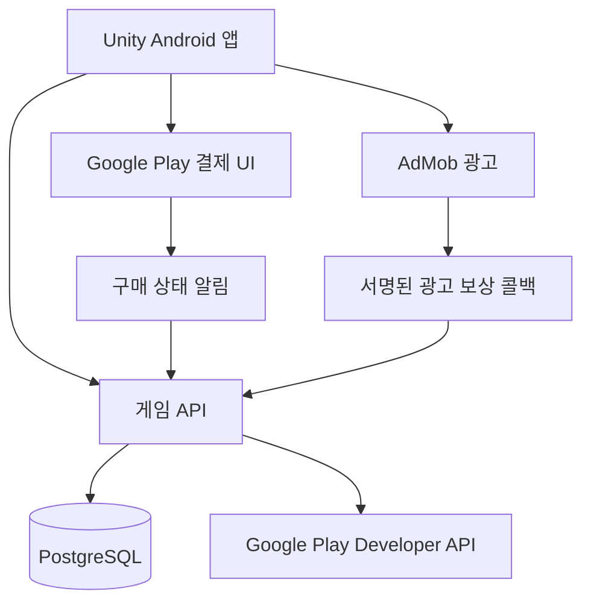

# 서버와 안드로이드 출시 계획

## 최신 운영 상태: 2026-11-05 초대 없는 시작·RTDN

이 절은 아래의 이전 시점 기록보다 우선한다.

- 앱 **0.19.3 / code 22**: 첫 화면의 `서버에 저장하며 시작`으로 초대코드 입력 없이 게스트 계정을 만든다. Google 연결은 선택이며 기존 계정 복구와 로컬 체험도 제공한다. 기존 로컬 진행은 별도로 보관하고 서버로 자동 이관하지 않는다. 기존 로컬 이용자에게는 전환 안내를 먼저 표시한다.
- 가입 요청 전에 복구 비밀값과 미완료 가입 상태를 저장한다. 응답 실패·앱 재시작 시 같은 값으로 멱등 가입을 재시도한다. 이미 연결했던 계정은 bootstrap으로 복구한다. PlayMode HTTP 회귀 검증에서 실패 → 재시작 → 동일 계정 재시도 → 재연결 및 로컬 저장 보존을 확인했다.
- 운영 Lightsail에 `PUBLIC_REGISTRATION=true`, `REGISTRATION_ENABLED=true`와 서버 이미지 `scrapguard-api:0.19.3`을 적용했다. 기존 비공개 초대코드는 롤백용으로 유지한다. 가입 중단 스위치와 요청 제한은 유지한다. 배포 전 DB/키 백업을 검증했다. 실제 HTTPS에서 초대 없이 신규 가입·중복 요청·인증 복구를 확인하고 검증용 임시 계정만 삭제했다.
- 서버 검사 **326개**, Unity 기존 서비스 검사 **3개**, 신규 가입 PlayMode 회귀 검사 **1개** 통과. macOS 첫 화면 실행·버튼 검증 오류 **0개**와 캡처를 확인했다. 서명 Android AAB 생성 완료. Play 트랙의 code 22 업로드·게시 여부는 별도 콘솔 확인이 필요하며 빌드 성공을 배포 완료로 간주하지 않는다.
- **RTDN 연결 완료**: 주제 `projects/scrapguard-prod/topics/scrapguard-play-rtdn`, 구독 `projects/scrapguard-prod/subscriptions/scrapguard-play-rtdn-push`. Google Play 공식 알림 계정에 해당 주제의 Pub/Sub Publisher만 부여했다(사용자 실행 직전 승인).
- 푸시 인증 계정 `scrapguard-rtdn-push@scrapguard-prod.iam.gserviceaccount.com`은 사용자 관리 키·프로젝트 역할·Play 구매 접근 권한 없이 생성했다. HTTPS 대상과 OIDC audience는 모두 `https://api.scrapguard.win/v1/commerce/rtdn`. 지수 백오프 10~600초, 확인 기한 30초, 미확인 메시지 보관 7일, 구독 만료 없음, 페이로드 래핑 유지.
- Play에서 실시간 알림과 **정기 결제·무효화된 구매·모든 일회성 제품**을 저장했다. **2026-11-05 15:57:15 KST** Play 테스트 알림이 운영 서버의 OIDC 검증을 통과해 `refund_inbox`에 `testNotification / ignored` 1건으로 저장된 것을 읽기 전용 조회로 확인했다. 테스트 메시지는 재화를 변경하지 않으므로 ignored가 정상이다. 실제 주문의 RTDN 환불 회수는 후속 구매·환불 검증 대상이다. 기존 주기 환불 조회도 정상 유지한다.
- 실결제·수익 광고는 아직 `COMMERCE_MODE=license_test`, `ADS_MODE=test`다. 비공개 테스트에서도 라이선스 테스터가 아닌 구매자는 실제로 과금될 수 있으므로 Google 구매창의 테스트 수단을 확인해야 한다. [공식 결제 테스트 안내](https://developer.android.com/google/play/billing/test?hl=ko)
- 실결제 전환 전 한국 판매자 정보의 실제 적용 요건을 해결해야 한다. 이전 `없음` 제출이나 비공개 테스트 승인을 판매 요건 충족으로 간주하지 않는다. 수익 광고는 AdMob 스토어 연결·앱 준비 상태 확인 후 전환한다. [국가별 배포 요건](https://support.google.com/googleplay/android-developer/answer/6223646?hl=ko), [AdMob 앱 준비 상태](https://support.google.com/admob/answer/10564477?hl=ko)
- **사용자 결정: 룬테스트 종료 후 앱 업데이트 배포.** 현재 Alpha의 code 21 / 0.19.2와 테스터 목록·참여 상태를 유지한다. code 22는 업로드·심사 제출·배포하지 않았다. 콘솔에서 빈 임시 출시(`/releases/2/prepare`) 작성 화면만 열었다. 서명 AAB SHA-256: `d111d014c42a0a43fce9f87c2122fb7ca38d127c49da3f073a933291db590635`. 서버 최소 버전은 올리지 않는다.
- AdMob 실조회: 계정은 승인됐지만 고철 수호대 앱은 **검토 필요 / 광고 게재 제한 / 스토어 미연결**. 정확한 패키지명 검색 결과가 없어 스토어 연결을 완료하지 못했다. 실제 수익 광고 전환은 보류한다. 콘솔에서 제공한 게시자 인증 문구를 `https://api.scrapguard.win/app-ads.txt`에 배포하고 HTTP 응답 내용을 검증했다. 이는 AdMob 크롤링·앱 승인 완료와는 다르다. 스토어 공개 후 개발자 웹사이트와 연결·크롤링 상태를 확인한다.

## 확정한 앱·프로젝트 식별자

| 항목 | 값 | 상태 |
| --- | --- | --- |
| 게임 표시 이름 | 고철 수호대 | 앱에 적용 |
| Android 패키지 | `io.github.hwangyeonjoon.scrapguard` | 앱·서버 기본값·검증 도구에 적용 |
| Google Cloud 프로젝트 표시 이름 | Scrap Guard | 2026-11-04 콘솔 생성 확인 |
| Google Cloud 프로젝트 ID | `scrapguard-prod` | 생성 완료, 프로젝트 번호 `731250151459` |

Play Console에는 새 게임 앱을 생성하고 위 패키지로 서명 AAB를 올린다. 같은 Google 계정의 Cloud 프로젝트에서 Android OAuth(위 패키지 + 실제 배포 서명의 SHA-1), Web OAuth, 구매 검증용 서비스 계정을 준비한다. AdMob도 기존 계정에 별도 앱과 보상형 광고 단위를 생성한다. 프로젝트 ID와 OAuth Client ID, AdMob App ID는 서로 다른 값이다.

패키지명은 이전 프로토타입과 달라 Android에서 별도 앱으로 설치된다. 이전 로컬 저장이나 세션을 자동으로 가져오지 않는다. 실제 콘솔 등록·서명 준비 상태는 아래 진행 기록을 기준으로 한다.

## 2026-11-04 콘솔 연결 진행 상태

### 최신 상태: 가상 기기와 테스트 연결 (2026-11-04 후속)

**18:23 이후 추가 진행 (아래 이전 시점 기록보다 우선)**

- 사용자가 가상 기기 Play 스토어 로그인을 완료했다. Play 내부 테스트에 code 20 / 0.19.1을 업로드·출시했으며 트랙 활성, 내부 테스터 제공됨을 확인했다. 이전 code 19는 출시에서 제외했으며 아티팩트 라이브러리에 남아 있다. 정식 공개 출시가 아니다.
- 기존 `MrStudio 내부 테스트` 이메일 목록의 구성원이 `duswnsghkd@gmail.com` 한 명임을 확인하고, 고철 수호대 내부 테스트 대상으로 지정했다. 같은 목록을 계정 전체 라이선스 테스트에도 지정하고 저장 완료를 확인했다. 다른 테스터 목록은 선택하지 않았다. 본인 계정의 테스트 참여 수락도 완료했다. 참여 링크: https://play.google.com/apps/internaltest/4700534561263803105 . 초기 스토어 상세 페이지는 아직 Not Found였다.
- Play 콘솔에서 code 20의 서명된 범용 APK를 내려받아 Play 앱 서명 SHA-1 일치를 확인하고 ADB로 가상 기기에 설치했다. 파일: `Builds/Android/ScrapGuard-play-20.apk`, SHA-256 `64a2a5f0029b41ff02a0f4cb71ec932320d7f551cf3a215d4cf43c4a063da0fa`. 이는 스토어 다운로드 완료를 뜻하지 않는다. 사용자가 앱 아이콘과 정상 시작 화면을 확인했고 검은 화면/종료는 없다고 답했다.
- Google 구매 검증 API의 읽기 전용 voided purchases 조회가 **HTTP 200 / 0건**으로 전환됐다. 이 조회 자체는 구매·지급·소모·환불 검증 완료와는 다르다.
- Play에서 `gems_300`의 `standard` 구매 옵션을 활성화했다(대한민국, 2,200원). 나머지 4개는 여전히 초안이다. 서버는 `COMMERCE_MODE=license_test`, `COMMERCE_SALES_ENABLED=true`, `COMMERCE_RELEASE_READY=false`, `COMMERCE_DISABLED_PRODUCTS=gems_600,gems_1200,gems_2600,ad_skip_lifetime`. 임시 계정 API로 `licenseTest=true`, `salesEnabled=true`, `saleProducts=[gems_300]`을 검증하고 해당 임시 계정을 삭제했다. 실제 청구를 방지하려면 구매창의 테스트 카드 표시를 사용자가 확인해야 한다.
- 사용자는 게임의 `계정과 저장` 화면까지 진입했다. 서버 주소는 `https://api.scrapguard.win`, 신규 계정은 복구 코드를 비우고 비공개 초대 코드를 입력한다. 본인용 코드 파일은 Git 제외·0600의 `UserSettings/Secrets/beta-invite.txt`이다. 사용자가 신규 가입 및 “구글 계정 연동 완료” 메시지를 확인했다. 당시 서버 읽기 전용 조회로 accounts=1, google_accounts=1, purchases=0을 확인했다. Google 토큰이나 계정 식별자는 출력하지 않았다.
- **18:42 KST 테스트 구매 성공:** 사용자가 구매 완료를 확인했고, 서버 읽기 전용 조회에서 `gems_300` 구매 1건, `is_test=1`, 지급/미사용 보석 각각 300개, `revoked=0`, 검증 오류 없음이 확인됐다. 지갑은 `gems=300`, `paidGems=300`, `gemDebt=0`, `testProgress=true`이며 `play_purchase` 원장 +300이 정확히 1건이다. Google 테스트 구매의 서버 검증·지급까지 확인했으며, SDK 소모 완료·재접속/복원·환불·광고 보상은 추가 확인이 필요하다.


이 절이 아래 초기 배포 당시 상태보다 우선한다.

- 사용자가 구매 후 앱을 종료하고 재실행한 뒤에도 보석 300개가 유지됨을 확인했다. 재실행 후 구매 잔액 유지까지 확인했으며, 재설치/다른 기기 복원 및 환불 검증과는 구분한다.

**2026-11-05 구매 복원·환불 실연동 검증**

- 커밋 `d693df4`를 `origin/main`에 푸시하고 원격 SHA 일치를 확인했다.
- 사용자가 설정의 구매 복원을 열어 보석 300개 유지를 확인했다. 이어서 서버에서 구매 1건, `play_purchase` +300 원장 1건, 지갑/유료 보석 각각 300, 부채 0을 읽기 전용으로 확인했다. 중복 지급은 없었다. 소비 완료된 보석을 Google에서 다시 지급받는 복원이나 재설치/다른 기기 계정 복원을 검증한 것은 아니다.
- 10:23:31 KST Play Console에서 `Test: 보석 300개` / `gems_300` 테스트 주문을 전액 환불하고 이용 자격을 취소했다. 주문 상태 `환불됨`, 합계 0을 확인했다. 실제 청구 주문은 처리하지 않았다.
- Google Voided Purchases API에 환불 1건이 반영됐다. 10:24:43 KST 기존 서버 주기 조회가 자동으로 회수했으며, 구매 `revoked=1`, `remaining=0`, 지갑 `gems=0`, `paidGems=0`, `gemDebt=0`, `play_refund` -300 원장 1건을 확인했다. DB 수동 수정 없이 Google 환불 → 서버 자동 회수를 검증했다. RTDN 실시간 경로는 아직 미연결이다.
- 사용자가 환불 후 앱 재실행 시 보석 0개 표시를 확인했다. 환불 이후 구매 복원 재실행에서 재지급되지 않는지 추가 확인은 별도다. 사용 후 환불 부채 처리, 비소모성 상품 복원, 다른 기기 복원은 별도 검증 항목이다.
- Play Console 개인정보처리방침에 `https://api.scrapguard.win/privacy`를 저장하고 대시보드의 작업 완료 표시를 확인했다. 비공개 테스트는 아직 시작하지 않았다.
- 별도 Google Play 심사 계정을 생성·접속 검증했다. 모든 5개 대원·42개 작전·10종 의상·광고 제거와 검토 재화를 제공했고 `testProgress=true`, 공개 프로필 비공개, moderation 숨김으로 일반 랭킹/전시실 및 BM 집계에서 분리했다. 신규 계정만 처리했으며 DB 사전 백업, `review_seed` 원장·운영 감사 기록을 남겼다. 복구 코드는 Git 제외 `UserSettings/Secrets/play-review-account.json`(0600)에 보관한다. 사용자의 명시 승인 후 Play Console 로그인 세부정보에 영어 접속 안내와 전용 코드를 저장했다. 선택형 Google/파트너 기기 추가 테스트 공유는 껐다.

**2026-11-05 스토어 및 심사 자료 준비**

- 대상 연령 13~15세, 16~17세, 만 18세 이상 저장 완료. 데이터 보안 CSV `Store/data-safety.csv`를 공식 콘솔 양식에 가져와 9개 데이터 유형과 이용 목적을 검토·저장했다. 앱 계정/구매 구현, 개인정보처리방침과 [Google Mobile Ads 공식 공개 안내](https://developers.google.com/admob/unity/privacy/play-data-disclosure)를 기준으로 작성했다. 독립 보안 인증·가족 정책 배지를 주장하지 않는다.
- 한국어 이름·간단한 설명·상세 설명은 `Store/ko-KR/*.txt`. 실제 구현된 5개 대원, 7개 지역/42개 작전, 10종 의상, 필살기·길드 지원·전시실을 소개하며 비공개 테스트/초대 코드/온라인 기능 제한을 고지한다.
- `Store/ko-KR/feature-graphic-v1.png`: 기본 내장 imagegen으로 생성한 홍보용 대표 그래픽. 프롬프트: “기존 중장비 정비사 루크 스프라이트를 캐릭터 참조로, 오른쪽에 주인공 하나, 어두운 청록 산업 정비소와 작은 고철 몬스터, 따뜻한 불꽃, 왼쪽에 정확한 ‘고철 수호대’와 ‘SCRAP GUARD’ 로고. UI·가격·평점·스토어 로고 없이 PG 수준의 게임 일러스트, 안전 여백. 게임플레이 캡처로 표현하지 않음.” 생성 후 스토어 규격 1024×500으로 내보냈다. 원본은 Codex 생성 이미지 폴더에 보존했다.
- 스토어 아이콘은 실제 앱 아이콘과 일치하도록 기존 이미지를 512×512으로 내보냈다. 향후 브랜드 아이콘 교체는 앱 아이콘과 함께 진행한다.
- 사용자가 ADB 가상 기기 조작·캡처를 명시적으로 허용했다. 실제 Play 서명 code 21 앱에서 홈·전투·의상 상점·의상 미리보기 4장을 촬영했다. `Store/ko-KR/phone-screenshots/01-home.png`부터 `04-outfit-preview.png`까지 모두 1080×1920, 8MB 미만이며 개발 빌드 표시가 없다. 과거 개발 빌드 이미지는 사용하지 않는다. 촬영용 해상도 변경은 종료 후 원래 값으로 복구했다.
- 한국어 스토어 문구·아이콘·대표 그래픽·실제 화면 4장의 업로드와 최종 저장을 확인했다. 대표 그래픽에는 AI 생성 애셋 라벨을 지정했다. 콘솔 상태는 `검토를 위해 전송 준비 완료`이며 아직 심사 승인/공개가 아니다.
- 공개 개인정보처리방침에 계정을 유지한 채 일부 데이터를 삭제하는 요청 경로를 명시하고 서버에 배포했다. 공개 HTTPS 응답에서 반영을 확인했으며 수정일은 2026-11-05다.
- 사용자가 IARC 약관 동의를 명시적으로 승인했다. 로봇 대상 판타지 전투, 만화풍·비현실적 반응, 멀리서 잦은 전투, 유혈 없음으로 작성했다. 처음 저장한 설문의 디지털 구매 `아니요`는 새 설문으로 정정해 `예 / 디지털 재화 구매`로 저장 완료했다. 유료 확률형 아이템·이용자 간 유료 거래·현금 보상·NFT는 없다. 자유 채팅/미디어 공유·정확한 위치 공유·선전/테러/사실적 범죄 묘사도 없다. 공개 닉네임·전시실·길드 지원과 자유로운 콘텐츠 교환 기능을 구분했다.
- 수정 설문에서 한국 GRAC는 `전체이용가 / 폭력성 / 인게임 구매`다. 콘텐츠 등급과 서비스 타겟 연령은 별개이며 타겟 13세 이상은 유지했다. 콘텐츠가 바뀌면 설문도 재검토한다.
- 비공개 테스트 `Alpha` 트랙(`4698093358919069306`)에 대한민국, 본인 1명인 `MrStudio 내부 테스트` 목록, 공개 지원 이메일을 저장했다. 기존 다른 앱의 테스터 목록은 연결하지 않았다. 모집 명단은 사용자가 준비한다.
- 라이브러리의 기존 code 21 / 0.19.2를 Alpha release 1에 추가하고 `0.19.2 (21) - 첫 비공개 테스트`로 저장했다. 출시 노트는 `Store/ko-KR/release-notes-0.19.2.txt`다. 빌드 차단 오류 없이 가독화 파일·네이티브 디버그 기호 미등록 경고 2개가 표시됐다.
- 사전 검사에서 광고 ID 선언과 대한민국 개발자 계정 추가 정보가 차단 사유로 나왔다. AdMob SDK의 광고 ID 사용을 `예`, 목적을 애널리틱스·광고/마케팅·사기 예방/보안/규정 준수로 선언·저장했다. 이후 광고 ID 차단은 사라졌다.
- 사용자가 기존 인증 연락처를 공개 개발자 전화번호로 사용하는 데 동의했고 문자 인증을 직접 완료했다. 공개 번호의 `전화번호 확인됨` 및 계정 `변경사항이 저장되었습니다`를 확인했다. 전체 전화번호는 저장소에 기록하지 않는다.
- 이후 사용자가 계정의 판매자 상태를 업데이트했고 `판매자` 표시를 확인했다. 사용자의 앱별 선언 진행 요청에 따라 고철 수호대에 `예, 이 앱에 판매자 상태가 적용됨`을 저장했다. 선택 항목인 서비스 약관 URL은 아직 별도 약관 페이지가 없어 비워 두었다. 게시 개요에서 `앱 수준 판매자 상태 선언 완료`와 제출 대기 변경사항 16개를 확인했으며, 앱별 판매자 선언 오류는 해소됐다. 다른 앱의 선언은 변경하지 않았다.
- 전화번호 저장 후에도 `대한민국 개발자 계정 세부정보 업데이트` 차단 1개가 남아 있다. 계정의 한국 추가 정보 3개(사업자등록번호·통신판매업 신고번호·신고기관)는 비어 있어 사용자에게 실제 등록 상태를 확인 요청했다. 누락 항목과 반영 지연 가능성은 구분해 확인해야 한다. **Google 검토 전송 및 비공개 테스트 제공은 아직 완료하지 않았다.** 계정 차단 해소 → 검토 전송 → 승인/제공 확인 → 모집한 테스터 등록·참여가 남아 있다. 준비용 참여 URL은 `https://play.google.com/apps/testing/io.github.hwangyeonjoon.scrapguard`이며 게시 전에는 이용 가능하다고 안내하지 않는다.

**2026-11-05 광고 연결 후속**

- 상점 → 보급 · 장비 → 추가 보급 부품 ×10의 광고 보상에서 “현재 광고를 이용할 수 없어요”가 표시됐다. 가상 기기의 UMP 로그에서 고철 수호대 AdMob App ID에 대한 `Publisher misconfiguration: ... no form(s) configured` 오류를 확인했다. 광고 로드 이전의 동의 준비 단계에서 차단됐으며 당시 서버 광고 요청은 0건, 부품은 30개였다.
- AdMob에 `고철 수호대 · 유럽 광고 동의` 메시지를 새로 만들고 **게시됨**을 확인했다. 대상 앱은 고철 수호대만 선택했으며 개인정보처리방침은 `https://api.scrapguard.win/privacy`, 기본 언어는 영어, 표시 지역은 EEA·영국·스위스다. 동의·동의하지 않음·옵션 관리 버튼을 제공한다. 기존 빈틈배송 메시지는 변경하지 않았다. 콘솔은 반영에 최대 1시간이 걸릴 수 있다고 안내했다. 앱 재실행 후 UMP 재조회 및 실제 테스트 광고 시청·SSV 보상 확인이 남아 있다.
- 게시 후 재실행 로그에서는 기존 publisher configuration 오류가 사라지고 UMP가 `IABTCF_gdprApplies=0`을 기록했다. 하지만 앱은 계속 광고 이용 불가를 표시했다. `RewardedAds`가 UMP 완료 콜백을 `MobileAdsEventExecutor.ExecuteInUpdate`에 넣으면서 처리기를 만들지 않아, `MobileAds.Initialize` 이전의 동의 완료 처리가 진행되지 않는 순환 대기를 확인했다. 광고 서비스 생성 시 Unity 메인 스레드 처리기만 먼저 초기화하도록 수정했다. 광고 초기화/요청은 기존 동의 검사 이후에만 수행한다. 동의 결과 로그에는 준비 여부와 오류 코드만 기록한다.
- PlayMode 회귀 테스트 `ConsentCallbackRunsBeforeAdvertisingSdkInitialization`에서 광고 SDK 초기화 없이 백그라운드 완료 콜백이 Unity 메인 스레드에서 정확히 1회 실행됨을 확인했다(1/1 통과, `TestResults/ad-consent-dispatch.xml`). 수정 빌드는 0.19.2 / code 21이며 실제 가상 기기 적용·광고 보상 검증은 이어서 진행한다.
- code 21 서명 AAB 생성 및 Play 내부 테스트 release 2 배포 완료(11월 5일 10:06 KST, 내부 테스터에게 제공됨). 첫 패키징의 AAPT2 daemon 시작 실패는 증분 재빌드로 해결했다. 출시명은 `0.19.2 (21) - 광고 동의 초기화 수정`이다. 가독화 파일·네이티브 디버그 기호 미등록 경고 2개가 남아 있으며 배포 차단 오류는 없었다.
- Play 서명 범용 APK의 패키지·code 21 / 0.19.2 및 기존 Play 인증서 일치를 확인한 뒤, `adb install -r -i com.android.vending`으로 가상 기기 업데이트 성공을 확인했다. 기존 앱 데이터는 삭제하지 않았다. 파일은 `Builds/Android/ScrapGuard-play-21.apk`, SHA-256은 `157f0f934dd09765e9462417af63137d04ff19fe4af2640cea0a9b1ae78427ec`이다. 이는 Play 스토어에서 다운로드한 업데이트 경로의 검증을 의미하지 않는다. 사용자에게 앱 실행과 광고 보상 재시도를 요청했으며 실제 시청·SSV 지급 결과는 아직 미확인이다.
- 업데이트 후 기기 조회에서 `versionCode=21`, `versionName=0.19.2`를 확인했고 새 Unity 프로세스 로그에 **`SCRAP_AD_CONSENT ready=True error=none`**이 기록됐다. 광고 이용을 막던 동의 완료 콜백의 진행 문제는 기기에서도 해소됨을 확인했다. 광고 로드·시청 및 보상 지급 검증은 별도다.
- 사용자가 빌드 21에서 실제 광고 화면이 열리고 상단에 **Test Ad**가 표시됨을 확인했다. 이어서 서버 읽기 전용 조회로 이번 `parts` 광고 요청 1건이 `test=1`, `status=granted`, `parts=10`임을 확인했다. 요청 전 부품 50개에서 **60개**로 증가했고 `dailyRewardParts=1`, 보석 300개가 유지됐다. 이번 테스트 광고의 로드·표시 및 서버 SSV 검증 후 보상 지급까지 확인했다. 광고 요청/거래/계정 식별자는 출력하지 않았다.

- Google 공식 Android Emulator 37.2.13과 Android 15 / API 35 Google Play ARM64 이미지를 설치했다. AVD는 `ScrapGuard_Play_API35`(Pixel 7), 데이터는 Git 제외 `UserSettings/Android/`에 있다. `sh Tools/start_android_emulator.sh`로 다시 실행한다. 초기 실행이 빌드 중 멈춰 CPU 2개·RAM 2560MB·SwiftShader 설정으로 재시작하고 ADB의 부팅 완료 값 1을 재확인했다. Play 스토어 계정 로그인은 사용자가 진행해야 한다. 가상 기기 결과로 실기기 성능·발열 검증을 대체하지 않는다.
- 가상 기기 재종료 후속: macOS 충돌 보고서에서 HangDetector 강제 종료와 그래픽 컨텍스트 오류를 확인했다. Vulkan 비활성화만으로는 약 3분 후 멈춤이 재발했다. 충돌 스택에서 QEMU 주 스레드가 macOS CoreAudio의 장치 시작 대기, CPU 스레드는 같은 잠금 대기 상태임을 확인했다. 재실행 스크립트에 `-feature -Vulkan -no-audio`를 적용했다. 현재 가상 기기는 무음이며 사운드 검증은 별도다. 무음 설정으로 3분 이상 ADB 응답 및 Google 로그인 Checking info 화면 이후 입력 화면까지의 진행을 확인했다(로그인 성공은 아직 확인 전). Mac 키보드 입력을 위해 AVD의 `hw.keyboard=yes`, `hw.keyboard.lid=no`로 변경했다. `Tools/OpenAndroidEmulator.command`를 Finder에서 더블클릭해 재실행할 수 있다. QEMU 내부 바이너리를 직접 실행하면 라이브러리 탐색 오류가 발생하므로 SDK의 emulator 런처를 사용한다. 기존 AVD 데이터는 초기화하지 않았다. 장시간 안정성 및 로그인 화면 조작 검증은 별도다.
- 서명 AAB **0.19.1 / code 20** 생성 및 manifest 패키지·버전 확인 완료. `Builds/Android/ScrapGuard-internal-test.aab`. Unity 서비스 테스트 **3/3**, 서버 검사 **324개** 통과. Play에는 아직 새 AAB를 업로드하지 않았다.
- 공개 홈페이지와 `/privacy`, `/support`, `/delete-account`를 **https://api.scrapguard.win**에 배포했다. 앱에도 동일 URL을 반영했다. 웹 탈퇴는 복구 코드를 Authorization 헤더로만 전송한다. 실제 임시 계정 생성·삭제 후 이전 코드가 401로 거절되는 것을 확인했다. Play Console 개인정보처리방침/데이터 보안 제출은 별도 남아 있다.
- `REGISTRATION_ENABLED=true`로 전환했으며 **비공개 초대 코드가 있어야 가입**된다. 익명 공개 가입은 아니다. Google 로그인 연동·복구의 기기 검증은 아직 남아 있다.
- 구매 검증 서비스 계정 키를 서버의 비공개 경로에 소유자 전용 권한으로 배치하고 읽기 전용 마운트했다. `COMMERCE_MODE=license_test`, `COMMERCE_SALES_ENABLED=false`, `RTDN_ENABLED=false`. Google API 토큰 발급은 성공하지만 앱 조회가 여전히 `404 applicationNotFound`로 실패한다. 내부 테스트 출시·테스터/라이선스 테스터 등록·상품 활성화·구매/환불/RTDN 연결 검증을 마쳐야 한다. 실결제 판매를 열지 않았다.
- 앱 `adsEnabled=true`, `productionAds=false`, 서버 `ADS_MODE=test`. 실제 광고 단위를 사용하되 SDK 기본 테스트 기기로 처리되는 에뮬레이터만 별도 ID 없이 허용한다. 물리 기기는 테스트 기기 ID 등록이 필요하다. 연령 선택 검증 전에는 모두 TFUA=true 및 G 등급 요청을 적용한다. 실제 수익 광고·UMP 동의/연령 흐름·스토어 연결/검토는 미완료다.
- AdMob SSV URL **https://api.scrapguard.win/v1/ads/ssv**의 Google 서명 검증과 콘솔 URL 확인에 성공해 저장했다. 콘솔은 실제 단위 대신 `1234567890`을 전송한다. `ADS_MODE=test`일 때만 사용자 ID `scrapguard-ssv-probe`, 맞춤 데이터 `configuration-check` 및 최근 시각을 검증해 **보상 없이** 설정 확인 응답을 준다. 실제 광고 보상은 기존 계정·요청·광고 단위·서명·중복 검증을 모두 통과해야 한다. 콘솔 연결 확인은 실제 광고 시청→보상 지급 테스트의 완료를 뜻하지 않는다.
- 일일 백업 systemd timer를 설치하고 실행을 확인했다(03:15 UTC + 최대 5분 지연). DB/키를 함께 백업하며 29일 이상 지난 로컬 사본을 다음 실행에 정리한다. 별도 장애 도메인의 암호화 백업은 아직 없다. 고객지원 메일 3년 보관 상한은 운영자가 직접 준수해야 하는 정책이며 자동 메일 삭제 기능은 없다.
- `CLIENT_LATEST_BUILD=20`, `CLIENT_MIN_BUILD=19`, `CLIENT_LATEST_VERSION=0.19.1`, `PLAY_UPDATE_AVAILABLE=false`. 아래 초기 HTTPS 10/10 보고서는 가입/결제/광고를 모두 껐던 시점의 검사이며 현재 상태를 나타내지 않는다.


기존 Play Console 개발자 계정과 AdMob 계정에 브라우저로 접근했다. AdMob에서 **고철 수호대 / Android / 스토어 미등록** 앱을 생성하고 ‘추가가 완료되었습니다’ 화면까지 확인했다. 기존 빈틈배송 앱과 별도 앱이며, 다시 진행할 때 새 앱을 중복 생성하지 말고 AdMob 앱 목록에서 고철 수호대를 선택한다.

보상형 광고 단위 `scrapguard_rewarded`를 생성하고 완료 화면과 광고 단위 목록에서 다음 식별자를 확인했다. 클라이언트 설정과 서버 배포 환경 예시에 반영했으며 광고 활성화는 아직 하지 않았다.

| 항목 | 확인한 값 |
| --- | --- |
| AdMob App ID | `ca-app-pub-6176006174123307~8500016434` |
| 보상형 광고 단위 ID | `ca-app-pub-6176006174123307/7008464653` |
| 리워드 수량 / 상품 | `1` / `reward` |

SSV 콜백에는 실제 공개 서버의 `/v1/ads/ssv` 주소가 필요하며 아직 등록하지 않았다. 테스트 기기 ID, 공개 개인정보처리방침 URL, UMP 메시지 및 동의 흐름 검증, 스토어 연결·앱 검토도 남아 있다. `adsEnabled=false`, `productionAds=false`, 서버 `ADS_MODE=disabled`를 유지한다. 실제 ID로 테스트 광고를 요청하려면 등록된 테스트 기기가 필요하다. Cloud와 Play의 앱 등록은 완료했지만 결제 상품·OAuth·RTDN은 아직 연결하지 않았다.

사용자는 **13세 이상 대상, 성인 중심 성장·수집 게임** 방향을 승인했다. Play Console 대상 연령은 실제 콘텐츠·마케팅에 맞춰 13–15세, 16–17세, 18세 이상으로 구성한다. 이는 콘텐츠 등급 확정이 아니며 등급 설문은 실제 전투·상품 내용을 기준으로 별도 작성한다. 청소년도 포함하므로 광고 연령 처리와 지역별 동의 설정 검증은 필요하다. 향후 아동 대상으로 디자인·마케팅을 변경하면 대상 연령과 Families 정책 적용 여부를 다시 검토한다.

사용자가 정책 준수·수출법 동의와 앱 만들기를 직접 완료했고, **고철 수호대 대시보드**에서 생성 결과를 확인했다. Play 앱 ID는 `4972707747613434942`이며 [앱 대시보드](https://play.google.com/console/u/1/developers/8898884610263017382/app/4972707747613434942/app-dashboard)에서 계속 설정한다. 생성 시 입력은 고철 수호대 / `io.github.hwangyeonjoon.scrapguard` / 한국어 / 무료 게임이다. 기존 빈틈배송과 별도 앱이다.

Play의 **광고 포함 = 예**, **정부 앱 = 아니요**, **금융 기능 = 없음**, **건강 기능 = 없음**을 저장하고 저장 완료를 확인했다. 심사 제출이나 공개 출시는 하지 않았다. 대상 연령 설문은 광고와 로그인 세부정보 작성을 선행 요구한다. 로그인 세부정보는 계정·결제·초대 코드 등 제한이 있는 경우 심사자가 전체 기능에 접근할 방법을 요구하므로, 실제 공개 서버와 심사용 접근 방법을 마련한 뒤 작성한다. ‘제한 없음’으로 임의 제출하지 않았다. 대상 연령은 제품 방향만 13세 이상으로 확정했으며 콘솔에는 아직 저장하지 않았다.

대시보드에서 이 앱의 프로덕션 신청 조건으로 **12명 이상이 최근 14일 연속 참여한 비공개 테스트**를 확인했다. 현재 참여 테스터는 0명이다. 서버와 도메인 준비는 아래 Lightsail 배포 진행 기록을 따른다.

### Google 로그인용 배포 서명 확인

2026-11-04 [Play 앱 서명](https://play.google.com/console/u/1/developers/8898884610263017382/app/4972707747613434942/keymanagement)에서 앱 서명 키가 사용 중임을 확인했다. 다운로드한 공개 인증서 묶음의 `deployment_cert.der`에서 추출한 SHA-256은 콘솔의 디지털 애셋 링크 값과 일치한다.

| 인증서 | 지문 |
| --- | --- |
| Play 배포 SHA-1 | `54:AB:CD:12:C9:ED:3B:6C:EB:3B:EA:73:EC:4A:E3:CF:C5:1A:3D:9B` |
| Play 배포 SHA-256 | `60:FB:7A:39:E3:56:0F:9B:60:AB:72:2E:45:17:81:F8:8E:44:B6:21:B0:5C:A5:CC:51:67:42:31:AF:F8:21:BA` |

Android OAuth는 패키지 `io.github.hwangyeonjoon.scrapguard`와 위 Play 배포 SHA-1을 사용한다. 로컬 업로드 키 지문과 혼동하지 않는다. 현재 Credential Manager 흐름은 웹 클라이언트 ID를 서버 `GOOGLE_WEB_CLIENT_ID`에 설정하고 서버가 nonce와 ID 토큰 audience를 검증한다. 웹 브라우저 리디렉션이나 Gmail·Drive 접근 권한은 필요하지 않다.

사용자가 웹 클라이언트 **Scrap Guard Server**를 생성했고 목록·상세 화면에서 확인했다. 공개 클라이언트 ID `731250151459-vkh6t26hjbr65508kvp3559l91g55c8g.apps.googleusercontent.com`을 서버 배포 환경 예시에 반영했다. 생성 시 선택된 AI 에이전트 분류는 게임 로그인 용도에 맞춰 해제하고 저장 완료를 확인했다. 클라이언트 보안 비밀은 이 ID 토큰 검증 흐름에서 사용하지 않으며 저장소에 넣지 않는다. Android 클라이언트 **Scrap Guard Android Play**도 생성했으며 ID는 `731250151459-01qehd591gkdp2kqgbolg8a1j2kiimfb.apps.googleusercontent.com`이다. 웹·Android 두 클라이언트가 목록에 표시되는 것을 확인했다. 실제 로그인 검증은 공개 서버 연결 후 수행한다.

### 구매 검증 서비스 계정 연결 결과

- Cloud 서비스 계정 `scrapguard-play-verifier@scrapguard-prod.iam.gserviceaccount.com` (고유 ID `112281145853917491426`)을 생성했다. Cloud 프로젝트 관리자·편집자 역할은 부여하지 않았다.
- Play Console에서 **고철 수호대 한 앱에만** 앱 정보 읽기·연동된 앱 품질 읽기·재무 데이터 보기·주문 및 구독 관리 권한을 설정했다. 계정 전체 권한은 모두 미선택이며 서비스 계정 상태 **활성**을 확인했다. 다른 앱·출시·사용자 관리 권한은 부여하지 않았다.
- JSON 키 한 개를 발급하고 로컬 `UserSettings/Secrets/google-play-service-account.json`에 이동했다. 디렉터리 `0700`, 파일 `0600`, Git 제외를 검증했다. 키 내용은 문서·앱·저장소에 넣지 않는다. 서버에는 아직 전송하지 않았다.
- 2026-11-04 실제 Google OAuth 토큰 발급은 성공했다. 읽기 전용 Voided Purchases 조회는 **HTTP 404 / `applicationNotFound` / `No application was found for the given package name.`** 이므로 구매 API 연결 검증은 아직 완료되지 않았다. 현재 AAB는 내부 테스트 출시 초안이며, 내부 테스트 배포와 Play 반영 후 같은 패키지로 다시 확인한다. 404의 원인을 출시 초안으로 확정한 것은 아니다. 이 결과로 테스트 구매·환불 검증을 대체하지 않는다.
- 현재 `COMMERCE_MODE=disabled`, 광고 비활성 상태를 유지한다. 공개 서버·테스트 배포·라이선스 테스터·실제 테스트 구매 이후 활성화한다.
- `compose.google.yaml`을 추가하고 `docker compose config`로 키 경로·읽기 전용 마운트·없는 호스트 경로 자동 생성 금지·결제 비활성을 확인했다. 컨테이너는 시작하지 않았다. 로컬 키 파일을 지정한 preflight는 OAuth ID·서버 키 파일·패키지·AdMob 식별자 설정을 확인했으며 공개 HTTPS·RTDN·광고 활성화·공개 안내 URL은 여전히 미완료다. 이는 설정 점검이며 실제 앱 로그인·구매 검증 결과가 아니다.

### Lightsail 서버 배포 진행

2026-11-04 사용자가 **scrapguard-prod** 인스턴스를 생성했고 콘솔의 Running 및 시스템·인스턴스 검사 Passed를 확인했다. 구성은 **서울 `ap-northeast-2a` / Ubuntu 24.04 LTS / General purpose / Dual-stack / 2 vCPU·2GB RAM·60GB SSD·3TB 전송 / 월 US$12**다. RDS와 Lightsail 관리형 DB는 만들지 않았으며 SQLite를 Docker 영구 볼륨에 저장한다. 유료 자동 스냅샷은 미선택이다.

- 고정 IP **52.78.162.152**, 이름 **scrapguard-prod-ip**를 생성해 서버에 연결했다. 이전 동적 IP는 사용하지 않는다.
- SSH(22)는 현재 작업 IP 1개와 기존 Lightsail 브라우저 SSH로 제한했다. 작업 장소가 바뀌면 콘솔에서 허용 IP를 갱신한다. 공개 HTTP(80)는 초기 규칙이며 사용자의 승인 후 HTTPS TCP(443)를 IPv4 전체에 허용했다. SSH 제한은 유지했다.
- SSH 키는 로컬 `UserSettings/Secrets/`에 파일 0600으로 보관한다. 실제 비밀키·초대 코드는 Git에 저장하지 않는다.
- Ubuntu 업데이트, 공식 Docker Engine/Compose, 2GB 스왑을 설치했다. 출처: [Docker Ubuntu 설치 문서](https://docs.docker.com/engine/install/ubuntu/).
- `/opt/scrapguard`에 서버·공용 코어 소스만 전송해 `scrapguard-api:0.19.0`을 빌드하고 API 컨테이너를 실행했다. API 8080은 호스트 공개 포트로 매핑하지 않는다. Caddy를 시작했고 Let’s Encrypt 인증서 발급과 자동 갱신 예약 로그를 확인했다.
- 내부 `/health`, `/health/ready`, `/health/services` 정상 응답과 `COMMERCE_MODE=disabled`, `newSales=false`, `ADS_MODE=disabled`, `rtdn=false`를 확인했다. `REGISTRATION_ENABLED=false`로 신규 가입 전체를 막았다. 초대 코드는 미리 설정했지만 가입을 활성화하기 전에는 초대 코드가 있어도 신규 계정을 만들 수 없다.
- 보안 업데이트 후 서버를 재부팅했고 API 자동 재시작과 DB ready 응답을 확인했다.
- 첫 온라인 SQLite 백업 `scrapguard-20261104T082134Z-23820.db`는 `BACKUP_VERIFIED`를 확인했고 재부팅 후 다시 `DATABASE_VERIFIED`를 확인했다. 자동 외부 백업과 별도 복구 실행 검증은 아직 남아 있다.
- Google 구매 검증 JSON은 아직 서버에 보내지 않았다. 웹 OAuth ID만 런타임 설정에 반영했으며 실제 로그인 검증은 남아 있다.

사용자가 Cloudflare에서 **scrapguard.win**을 구매했고 등록 성공과 Active를 확인했다. 구매 당시 첫해 **US$4.18**, 갱신 **연 US$5.18**이며 자동 갱신이 켜져 있다. Cloudflare DNS 레코드는 처음 조회 시 0개였다. 후속 진행 시 `api.scrapguard.win → 52.78.162.152` A 레코드(DNS only, TTL Auto)가 저장된 것을 확인했다. 사용자의 공개 승인 후 HTTPS 방화벽을 적용했다. **https://api.scrapguard.win**의 인증서 신뢰·호스트명 검증, HTTP 308 HTTPS 전환, API·DB 응답을 외부에서 확인했다. 인증서 만료는 2027-02-02이며 Caddy 자동 갱신을 사용한다. 루트 도메인의 공개 안내 페이지는 아직 없다.

공개 HTTPS 점검 **10/10**: DB ready, 공개 업데이트 정책, 신규 가입 전체 중지(503), 구버전 차단(426), 계정 인증 요구(401), 결제·광고·RTDN 비활성, 콘텐츠 조회를 확인했다. 보고서는 `TestResults/public-https-check.json`이며 실제 계정 생성이나 Google 거래를 수행하지 않았다. Unity 컴파일 및 기존 서비스 테스트 **3/3**도 통과했다(`TestResults/https-service-tests.xml`).

앱 `ClientConnection.json` 업데이트 조회 주소와 새 `CloudSession`의 기본 주소를 공개 HTTPS로 반영하고 계정 화면의 개발용 안내를 테스트 참여 안내로 정리했다. 기존 저장 세션의 주소는 유지한다. 이 변경은 로컬 소스에만 반영됐으며 기존 Play code 19 AAB에는 없으므로 새 버전 코드로 재빌드·업로드해야 한다. Play 업데이트 가능 플래그는 계속 false다.

- Cloud `scrapguard-prod`를 기존 프로젝트와 분리해 생성했고 실제 프로젝트 번호를 확인했다. [Google Play Android Developer API 사용 설정 화면](https://console.cloud.google.com/apis/library/androidpublisher.googleapis.com?authuser=1&project=scrapguard-prod)까지 준비했다. 사용자의 약관 동의 진행 승인 후 API를 활성화하고 상세 화면의 **사용 설정됨**을 확인했다. OAuth 기본 구성은 생성 완료 화면을 확인했다. 웹 OAuth 클라이언트는 생성·확인 완료했다. Android OAuth·구매 검증 서비스 계정·앱 한정 Play 권한 부여까지 완료했다. Pub/Sub는 아직 설정하지 않았다. Cloud 결제 계정도 연결하지 않았다.
- 사용자가 공개 고객지원 이메일로 **duswnsghkd@gmail.com** 사용을 승인했다. OAuth 구성에 앱 이름 **고철 수호대**, 대상 **외부 / 테스트 모드**, 지원·개발자 연락처에 이 주소를 입력했다. 이후 OAuth 개요에서 **OAuth 구성 생성됨**과 **아직 이 프로젝트에 OAuth 클라이언트를 구성하지 않았습니다**를 확인했다. 기본 구성 이후 웹 클라이언트 발급까지 완료했으며 현재 값은 위 Google 로그인 기록을 따른다. Play 스토어 등록정보 연락처에도 같은 주소를 저장하고 변경사항 저장됨 표시를 확인했다. 전화번호·웹사이트는 미입력이다.
- Play 스토어 카테고리는 **게임 / 액션**으로 저장 완료했다. 게시 개요에서 검토 전송을 기다리는 상태이며 검토 전송은 하지 않았다.
- 사용자가 기존 개인 결제 프로필 선택과 공개 판매자 등록 제출을 직접 완료했다. 공개 업체명 **MrStudio**, 제품·서비스 **컴퓨터 소프트웨어**, 지원 이메일 **duswnsghkd@gmail.com**, 카드 명세서 이름 **MRSTUDIO**로 작성했다. [결제 프로필](https://play.google.com/console/u/1/developers/8898884610263017382/paymentssettings)에서 Google Play 앱 결제 관리 화면이 열리는 것을 확인했다. 수익 지급용 결제 수단 추가와 15% 서비스 수수료 프로그램 신청은 남아 있다.
- 결제 권한을 포함한 첫 AAB를 Play에 업로드한 뒤 [일회성 제품](https://play.google.com/console/u/1/developers/8898884610263017382/app/4972707747613434942/one-time-products) 등록 제한이 해소됐다. 아래 5개 상품과 구매 옵션 `standard`를 생성하고 모두 **임시 / 활성 구매 옵션 0개**인 것을 목록에서 확인했다. 구매 유형은 구입이며 이전 버전과의 호환성이 표시된다. 대한민국만 사용 가능하고 나머지 국가·새 국가/지역은 사용 불가다. 한국 가격을 설정했으며 판매 활성화·실제 구매 검증은 아직 하지 않았다.

등록한 상품 ID와 한국 가격은 `Assets/Game/Core/CommerceCatalog.cs`와 동일한 아래 5개다. 모두 비활성 초안이며, 가격 표시는 Play 구매창에서 받은 현지 가격을 사용한다. 보석은 앱에서 소모 처리하는 일회성 구매이고 광고 스킵은 소모하지 않는 일회성 권리다. 정기 결제로 등록하지 않았다. 다중 수량 구매는 비활성 기본값을 유지한다.

| 상품 ID | 한국어 상품명 | 저장한 한국 가격 | 등록 내용 요약 |
| --- | --- | ---: | --- |
| `gems_300` | 보석 300개 | 2,200원 | 고철 수호대에서 사용할 보석 300개를 획득합니다. |
| `gems_600` | 보석 600개 | 3,900원 | 고철 수호대에서 사용할 보석 600개를 획득합니다. |
| `gems_1200` | 보석 1,200개 | 7,500원 | 고철 수호대에서 사용할 보석 1,200개를 획득합니다. |
| `gems_2600` | 보석 2,600개 | 14,900원 | 고철 수호대에서 사용할 보석 2,600개를 획득합니다. |
| `ad_skip_lifetime` | 영구 광고 스킵 | 9,900원 | 지원되는 보상형 광고를 시청하지 않고 보상을 받습니다. 각 보상의 이용 조건과 일일 횟수 제한은 유지됩니다. |

광고 스킵은 실제 광고/보상 흐름 검증 전까지 `COMMERCE_DISABLED_PRODUCTS=ad_skip_lifetime`로 판매를 막는다. 앱 결제창은 이 문서의 가격이 아닌 Play가 반환한 현지 가격을 표시한다. 광고 스킵 설명에는 추가 보석이나 이용 횟수를 제공하지 않는다는 점도 명시했다. 제품 아이콘과 별도 상품 연령 등급은 아직 추가하지 않았다. 보석 2,600개는 일괄 가격 적용 시 15,000원으로 반올림되어 개별 편집으로 14,900원에 맞췄고, 저장 후 구매 옵션을 다시 열어 14,900원을 확인했다.

### 업로드 서명 키

이 게임 전용 RSA 3072비트 업로드 키를 로컬에 생성했다. `UserSettings/Signing/`은 Git 제외 경로이고 키와 비밀번호 파일은 소유자만 읽고 쓸 수 있다. 키를 다른 앱에서 가져오지 않았다.

- 키: `UserSettings/Signing/scrapguard-upload.keystore`
- 로컬 서명 설정: `UserSettings/Signing/credentials.json` (비밀번호 포함, 공유·커밋 금지)
- 공개 인증서: `UserSettings/Signing/upload-certificate.pem`
- 업로드 인증서 SHA-1: `C3:0F:4E:A4:79:03:BB:09:1B:FA:39:4A:3E:2C:77:03:A5:DD:80:BA`

`python3 Tools/build_signed_aab.py --check`로 입력 존재 여부를 확인하고, `python3 Tools/build_signed_aab.py`로 내부 테스트용 AAB를 빌드한다. 비밀번호는 명령줄 인수 대신 자식 프로세스 환경으로 전달한다. 결과 경로는 `Builds/Android/ScrapGuard-internal-test.aab`다. 키 생성·설정 점검 통과만으로 AAB 빌드나 Play 업로드 완료를 뜻하지 않는다.

**2026-11-04 내부 테스트 AAB 생성·파일 검증 완료**: 95,774,105바이트, SHA-256 `c3e2dce5e2f7dce92b885f71cc0e53c7d1a6bec4310ae7c5d059f900f98831cb`. bundletool 검증, ZIP 무결성, JAR 서명 검증, 업로드 인증서 일치 확인을 통과했다. 패키지 `io.github.hwangyeonjoon.scrapguard`, 버전 `0.19.0` / code `19`, min SDK 26 / target SDK 36, ARM64, debuggable=false와 게임 전용 AdMob App ID를 확인했다. 자체 서명 인증서의 신뢰 체인·타임스탬프 경고는 별도 출력되며 서명 검증 종료 코드는 0이다. Play 업로드는 아래와 같이 완료했다. 실기기 실행·실결제 검증은 아직 하지 않았다. 서버 주소와 OAuth는 미설정이고 결제·광고도 비활성이다.

**Play 업로드 및 내부 테스트 초안 저장 완료**: [내부 테스트 출시 준비](https://play.google.com/console/u/1/developers/8898884610263017382/app/4972707747613434942/tracks/4700534561263803105/releases/1/prepare), 트랙 ID `4700534561263803105`, 출시 초안 `1`. 업로드 최적화 후 `App bundle 19 (0.19.0)`, API 26 이상 / target 36 / ARM64 행과 **변경사항이 저장되었습니다**를 확인했다. 출시명은 `0.19.0 (19) - 내부 연결 준비`이며, 한국어 출시 노트에 서버·로그인·실결제·광고 미연결 상태를 명시했다. 테스터 지정·내부 테스트 배포·심사 제출·공개 출시는 하지 않았다. Google Play App Signing 배포 인증서는 아직 별도로 기록하지 않았다.

첫 시도에서 Unity 라이선스/Android 모듈 초기화 문제로 성공 로그만 남고 AAB가 생성되지 않는 사례를 확인했다. 빌드 함수에 Android 지원 여부와 실제 출력 파일 확인을 추가했고, 래퍼는 새 파일 생성 시각·AAB 구조·ZIP 무결성을 검사한다. 라이선스 연결을 복구한 후 재실행하여 위 AAB를 생성했다. 로그는 `TestResults/android-internal.log`, 매니페스트 확인 결과는 `TestResults/android-internal-manifest.xml`이다.

이 디렉터리는 **Git clone으로 복원되지 않는다**. 업로드 키와 로컬 서명 설정을 비밀번호 관리자 또는 암호화 백업에 별도 보관하고 다른 개발 기기로 안전하게 옮겨야 한다. 현재 외부 백업은 만들지 않았다. Google Play App Signing 배포 인증서 SHA-1은 위 Google 로그인용 배포 서명 기록에 별도로 확인해 두었으며 Android OAuth 클라이언트에 등록한다. 위 업로드 인증서를 배포 인증서로 간주하지 않는다.

## 0.19 환불·통계·콘텐츠 운영

앱 0.19.0/code 19, 최소 호환 code 19. 클라이언트와 서버를 함께 배포한다. 결제·광고·RTDN 기본값은 비활성이고 외부 계정/공개 서버는 연결하지 않았다. 아래가 이전 환불·통계·예약 미구현 설명을 대체한다.

### 환불 수신과 장기 중단 복구

- `POST /v1/commerce/rtdn`: Google JWT 서명·issuer·audience·검증된 서비스 계정 이메일, 구독 경로·패키지를 확인한다. 수신함 DB 커밋 후 204를 반환한다. 동일 messageId 중복은 무시하고 내용 충돌은 거절한다. 게임 버전 헤더는 요구하지 않으며 게임 bearer로 인증을 대신할 수 없다.
- 알림 자체로 지급/회수하지 않고 Google 구매 API를 재조회한다. 취소 알림에 아직 PURCHASED가 보이면 재시도한다. 1분 주기로 최대 25개 처리, 실패 간격은 1~60분이다. Google 테스트/구독 알림은 보석 지급에 사용하지 않는다. 실제 결제는 기존 검증 경로에서만 지급된다.
- 환불 목록은 마지막 성공 시각을 저장하고 24시간 겹쳐서 시간 단위로 조회한다. 중복 회수는 원장이 차단한다. [Voided Purchases API의 조회 범위는 최근 30일](https://developers.google.com/android-publisher/api-ref/rest/v3/purchases.voidedpurchases/list)이므로, 그보다 긴 중단은 개별 구매 재검증으로 보완한다.
- 새 검증/복원부터 구매 토큰을 Data Protection으로 암호화 저장한다. 미회수 구매를 오래된 확인 순으로 1분당 최대 100개, 동일 건은 하루 간격으로 재검증한다. 목록 API 장애가 개별 재검증을 막지 않는다. API 실패·키 손실·기존 해시만 있는 구매는 자동 복구를 보장할 수 없으며 `refund-status`의 missingTokens/failures로 확인한다. 기존 해시 기록은 사용자의 정상 구매 복원 때 토큰을 보충한다. API가 더 이상 조회하지 못하는 거래는 Play Console 내역과 수동 대조한다.
- 회수 완료 시 암호화 토큰을 지우며 중복 방지용 해시는 유지한다. 계정 삭제 시 저장/대기 중 토큰을 제거한다. 완료 수신함은 35일 후 정리하며 실패한 건은 재시도를 위해 유지한다.
- `/health/services` 및 `--ops refund-status`에 대기 건수·최대 재시도·토큰 누락·재검증 실패·30일 초과 공백을 표시한다. 공백 표시는 과거 발생 사실로 유지되므로 운영자가 거래 대조 후 관리한다. `Tools/service_health.py`는 이 상태도 장애 신호로 반환한다.

실제 연결 순서:

1. 이 게임 Cloud 프로젝트에 Pub/Sub 주제와 인증 push 구독을 만들고, Play Console RTDN 설정에 주제를 연결한다. Google Play 게시자 권한과 push 서비스 계정의 ID 토큰 발급 권한을 공식 안내대로 설정한다.
2. `RTDN_ENABLED=true`, `RTDN_AUDIENCE=https://운영도메인/v1/commerce/rtdn`, `RTDN_SERVICE_ACCOUNT_EMAIL=구독의-push-서비스계정`, `RTDN_SUBSCRIPTION=projects/프로젝트/subscriptions/구독`을 지정한다. audience는 구독의 인증 audience와 정확히 일치시킨다. 결제 검증용 서비스 계정/ADC와 push 신원은 역할이 다르다.
3. 먼저 license_test 모드로 Play Console 테스트 알림, 실제 테스트 구매 취소, 서버 일시 중단 후 재전송을 검증한다. Pub/Sub 미전달 메시지·재시도도 별도로 모니터링한다. 외부 권한과 실제 Google 통신은 로컬 가짜 제공자 검사로 대체하지 않는다.

참조: [RTDN 구조](https://developer.android.com/google/play/billing/rtdn-reference), [인증된 Pub/Sub push](https://docs.cloud.google.com/pubsub/docs/authenticate-push-subscriptions), [개별 구매 v2 상태](https://developers.google.com/android-publisher/api-ref/rest/v3/purchases.productsv2).

**백업 변경**: `--backup-database`와 `Server/Deploy/backup.sh`는 DB와 인접한 `<DB경로>.keys`를 함께 복사한다. Docker에서는 `/data/scrapguard.db.keys`가 DB와 같은 영구 볼륨 안에 있다. 키 디렉터리는 운영 계정만 접근하도록 제한하지만 키 XML 자체는 별도 암호화되지 않으므로, DB+키를 외부에 보관할 때 암호화 저장소를 사용한다. 복구 시 서버를 정지하고 DB와 키 디렉터리를 새 DB 이름에 맞춰 **함께** 복구한다. 이전 버전의 DB만 복원하면 새 암호화 토큰을 읽지 못한다. 백업 사본에서 토큰을 실제 복호화하는 검사를 추가했다.

### BM 지표와 로컬 대시보드

앱 `설정 → 플레이 테스트 기록 → 온라인 의상 체험 통계`에 별도 선택 동의를 추가했다. 기존 기기 내 테스트 기록은 여전히 자동 전송하지 않는다. 동의한 온라인 계정의 미보유 의상 체험을 계정/의상/UTC 일자별 1회, 90일 보관하며 시간 단위 작업으로 만료 기록을 정리한다. 동의 철회는 서버 체험 기록을 삭제한다. 전송 실패를 오프라인에 쌓지 않으므로 일부 체험은 누락될 수 있다.

- 최근 7/30/90일: 동의한 체험 계정 중 기간 내 첫 체험 이후 7일 안에 구매한 계정 수/전환율. 최근 체험은 아직 관찰 중이다.
- 실제 구매 횟수는 성공한 서버 거래만 집계하고 재시도는 중복 합산하지 않는다. 기존 과거 구매 이벤트는 소급하지 않으며 보고서에 수집 시작 시각을 표시한다.
- 장착률은 **현재 장착 계정 / 현재 보유 계정**이다. 전투 사용 시간/노출률은 아니며 선택하지 않은 대원에 저장된 장착도 포함한다.
- 보석 수급은 서버 원장의 증가/감소를 경로별로 집계한다. 환불 회수는 소비와 별도 카드에 표시한다. 무료/유료 지갑 증감이지 현금 매출이 아니다. 구매 보석의 부채 상계분·환불 부채는 지갑 증감에 포함되지 않는다.
- 테스트 진행 계정은 기본 제외하며 `--include-tests true`로만 포함한다. 계정 삭제 시 연결된 통계도 제거한다. 보고서에는 계정 ID/복구 코드/구매 토큰을 싣지 않는다.

저장된 집계 JSON을 HTML로 만들며 서버 공개 관리자 페이지는 제공하지 않는다. 아래는 프로젝트 루트에서 실행한다.

```sh
docker compose -f Server/Deploy/compose.yaml exec -T api dotnet ScrapGuard.Server.dll --ops metrics > /private/tmp/scrap-metrics.json
python3 Tools/bm_dashboard.py --input /private/tmp/scrap-metrics.json --output /private/tmp/scrap-dashboard.html
docker compose -f Server/Deploy/compose.yaml exec -T api dotnet ScrapGuard.Server.dll --ops refund-status
```

HTML 파일은 외부 CDN/업로드 없이 브라우저에서 열며 보고서 생성 당시의 스냅샷이다. 새 지표는 다시 내보낸다. 개인정보 안내 페이지에도 선택 체험 통계·보관 기간·운영 원장 처리 내용을 출시 전에 반영한다.

### 의상 공개 예약

`GET /v1/content`와 모든 상태 응답에 서버 시각/의상별 시작·종료·중지·최소 빌드를 전달한다. 서버 거래가 시작 포함/종료 제외 경계를 검증하므로 기기 시간을 바꿔도 먼저 살 수 없다. 완료된 구매 재시도와 보유 의상 장착은 판매 종료 후에도 유지된다. 앱은 서버 시각에서 경과 시간을 계산하고 상점 진입 시 최대 30초 간격으로 새로 확인한다. 5분 넘게 갱신하지 못한 일정은 구매를 잠시 막고 재확인을 안내한다.

현재 10종은 모두 기존대로 판매 중이며, 운영자가 정할 때만 예약이 적용된다. 앱에 들어 있는 의상 ID만 예약 가능하고 새 원화/연출을 다운로드하는 기능은 아니다. 새 의상을 앱 업데이트에 먼저 포함하고, 같은 서버 버전으로 올린 뒤 예약한다. 오프라인 체험판에는 판매 예약을 적용하지 않는다.

```sh
docker compose -f Server/Deploy/compose.yaml exec -T api dotnet ScrapGuard.Server.dll --ops content
# 예시: 예약을 적용할 때 의상·날짜·운영자·사유·32자리 요청 ID를 직접 지정한다.
docker compose -f Server/Deploy/compose.yaml exec -T api dotnet ScrapGuard.Server.dll --ops content-set --outfit 10 --starts 2026-12-01T09:00:00+09:00 --ends 2027-01-01T09:00:00+09:00 --paused false --min-build 19 --operator OPERATOR --reason "12월 공개 계획" --request-id 9123456789abcdef0123456789abcdef
```

`content-set`은 전체 일정 교체다. starts/ends를 생략하면 해당 경계를 해제하고 `--paused true`는 신규 판매를 중지한다. 적용은 운영 감사 원장에 기록된다. 같은 요청 ID/같은 내용 재실행은 중복 적용하지 않고 다른 내용은 거절한다. 실수로 종료일을 지정하지 않도록 적용 후 `--ops content`로 확인한다.

검증: 서버 320개, Unity EditMode 110개, 로컬 Docker HTTP·백업·재시작 35개 통과. `TestResults/LiveOps019`의 실제 로컬 서버 동의/철회 및 360×800 예약 표시 검사 오류 0. 예약 화면 일부는 명시적인 UI fixture이며 예약 거래 경계는 서버 검사에서 검증했다. macOS·Android 개발 빌드 및 APK 0.19.0/code 19 ARM64·서명·16KB 정렬 확인. Google 실거래/RTDN 및 Android 실기기 실행은 미검증이다.

## 0.18 의상 카탈로그 배포

앱 0.18.0/code 18, 최소 호환 code 18, 전투 규칙 11. 신규 의상 ID 8~10과 극한 작업반 컬렉션을 추가했다. 기존 구매·장착은 보존하며 앱과 서버를 함께 갱신한다. 실제 결제·광고 연결과 Android 실기기 검증은 별도다.

## 0.17 의상 카탈로그 배포

앱 0.17.0/code 17, 최소 호환 code 17, 전투 규칙 11. 신규 의상 ID 5~7을 구버전 클라이언트가 잘못 해석하지 않도록 최소 호환을 올렸다. 앱과 서버를 함께 갱신하며 기존 구매·장착 ID는 유지한다. Cloud/Play/AdMob 외부 설정과 실제 기기 검증은 여전히 미완료다. 업데이트 안내는 스토어 이동 방식 그대로이며 공개 전 Play 배포 가능 플래그는 false다.

## 0.16 외부 연결 전 서비스 준비

앱 0.16/code 16, 최소 호환 code 14, 전투 규칙 11이다. 일반 구매 코드와 광고 SDK를 추가했지만 실제 Google 계정·공개 서버·광고·판매는 연결하지 않았다. 아래 내용이 과거 버전의 미구현 설명을 대체한다.

### 결제 설정

- `COMMERCE_MODE=disabled|license_test|production`. production은 `COMMERCE_RELEASE_READY=true`가 별도로 필요하다. 잘못된 설정은 시작 시 거절한다.
- `COMMERCE_SALES_ENABLED`는 신규 구매 버튼을 제어한다. 판매 중지 중에도 이미 청구된 구매 검증·복원은 허용한다. Play Console 상품 판매 상태도 함께 관리한다.
- `COMMERCE_DISABLED_PRODUCTS`는 판매에서 제외할 상품 ID 목록이다. 기본 배포에서는 광고 검증 전까지 `ad_skip_lifetime`을 제외한다.
- 테스트/일반 영수증을 상호 거절하며, 테스트 진행 계정은 일반 구매를 사용할 수 없다. 기존 유료/무료 원장·환불·부채 조정은 유지한다.
- `/health/services`는 결제/광고 모드와 환불 조회의 마지막 성공·실패, 연속 실패, 주의 필요 여부를 제공한다. 0.19부터 RTDN 수신함과 장기 복구 재검증을 함께 운영한다.

### 광고 설정과 보상 처리

기존 AdMob 계정에 **이 게임을 별도 앱으로 추가하고 새 App ID·보상형 광고 단위를 생성**한다. 다른 앱의 광고 ID는 재사용하지 않는다. [공식 앱 추가](https://support.google.com/admob/answer/9989980?hl=ko).

- SDK는 Google Mobile Ads Unity 11.6.0, Android Ads 25.5.0, UMP 4.0.0으로 고정했다. 설정이 활성화된 Android에서만 앱 시작 시 동의 정보를 갱신하고 `CanRequestAds()` 확인 후 요청한다. 필요한 경우 개인정보 선택 변경 버튼을 제공한다.
- `Assets/Resources/ServiceSettings.json`은 `adsEnabled=false`, `productionAds=false`를 유지하며 2026-11-04 생성한 게임 전용 App ID·단위 ID를 반영했다. 테스트 기기 ID·개인정보/문의/삭제 URL은 아직 미설정이다. 빌드 시 App ID를 SDK 설정에 복사한다.
- 서버 `ADS_MODE=disabled|test|production`, `ADMOB_REWARDED_UNIT_ID`. production은 `ADS_RELEASE_READY=true`와 게임 전용 단위를 요구한다. 앱/서버 단위와 모드가 일치해야 표시한다. test 모드의 게임 광고 단위에는 테스트 기기 ID가 필요하다. 샘플 광고 ID로 게임의 SSV를 설정할 수 없으므로 전체 검증은 게임 단위와 등록된 테스트 기기를 사용한다.
- AdMob 콘솔 보상은 **reward / 1**, SSV URL은 `https://운영도메인/v1/ads/ssv`로 설정한다. custom_data는 서버 claim ID, user_id는 공개 계정 ID다. 복구 코드를 보내지 않는다. 실제 골드·부품 지급량은 서버 예약 값으로 결정한다.
- 서버 예약은 동일 계정·보상 종류의 동시 요청을 막는다. 20분 또는 서비스 일자 종료 시 만료한다. 표시 실패·취소는 지급 횟수를 소비하지 않는다. 로컬 시청 완료 콜백은 재화를 지급하지 않는다.
- SSV는 원본 쿼리 ECDSA/SHA256 DER 서명, Google 키(12시간 캐시), 광고 단위·계정·요청·보상·시각·중복 거래를 검증한다. 지급·원장은 단일 DB 트랜잭션이다. 재시작 후 내역으로 확인하며 취소·만료된 요청은 늦은 콜백으로 되살리지 않는다.
- 영구 스킵은 동일 예약·지급·하루 한도를 사용하고 광고를 표시하거나 노출 이벤트를 보내지 않는다. 이전 앱의 스킵 명령도 대기 중인 예약과 충돌하면 거절한다.
- [SDK 설치](https://developers.google.com/admob/unity/quick-start), [SSV](https://developers.google.com/admob/unity/ssv), [UMP](https://developers.google.com/admob/unity/privacy). 대상 연령·국가와 콘솔 메시지는 연결 단계에서 확정한다.

### 운영자 CLI

서버 파일 접근 권한이 있는 운영자가 컨테이너 내부에서 실행한다. 외부 관리자 API는 제공하지 않는다. 예시의 공개 ID·운영자·요청 ID는 실제 값으로 바꾼다.

```sh
docker compose exec -T api dotnet ScrapGuard.Server.dll --ops summary
docker compose exec -T api dotnet ScrapGuard.Server.dll --ops reports
docker compose exec -T api dotnet ScrapGuard.Server.dll --ops account --account PUBLIC_ID
docker compose exec -T api dotnet ScrapGuard.Server.dll --ops audit
docker compose exec -T api dotnet ScrapGuard.Server.dll --ops hide --account PUBLIC_ID --operator OPERATOR --request-id 0123456789abcdef0123456789abcdef --reason "신고 검토 후 공개 제한"
docker compose exec -T api dotnet ScrapGuard.Server.dll --ops compensate --account PUBLIC_ID --operator OPERATOR --request-id 1123456789abcdef0123456789abcdef --reason "장애 보상 접수번호" --gold 1000 --parts 10
```

`hide`는 이름 초기화·공개 제한·신고 종결을 처리하고 해제 전 이름 변경과 재공개를 막는다. `unhide`는 제한만 해제하며 공개 동의는 켜지 않는다. `resolve`는 대상의 신고를 종결한다. 감사 기록은 운영자·사유·대상·요청 ID를 남기며 계정 삭제 시 계정 연결을 제거한다. 사유에 개인정보나 토큰을 넣지 않는다.

보상은 1회 최대 골드 10,000·부품 100이다. 같은 요청 ID 재실행은 중복 지급하지 않고 내용 변경은 거절한다. 임의 유료 보석 지급은 제공하지 않는다. 구매 미지급은 정상 복원으로 재검증한다. 운영 조회는 최근 구매·원장·광고 내역을 제공하며 인증/구매 토큰을 제외한다.

### 연결 전 점검

```sh
python3 Tools/release_preflight.py --env-file Server/Deploy/.env.example
python3 Tools/service_health.py --url http://127.0.0.1:5190
python3 Tools/service_health.py --url https://운영도메인 --backup-dir Server/Deploy/backups
dotnet run --project Tools/EconomyForecast
python3 Tools/local_load_check.py
```

preflight는 외부에 접속하지 않고 비밀값을 출력하지 않는다. 현재 미설정 항목 때문에 종료 코드 2가 정상이다. configuration_ready는 거래 검증이나 출시 승인이 아니다. 서명 변수 확인은 `--signing`으로 추가한다. 서비스 계정 파일은 검사 환경에서도 읽을 수 있어야 한다. health 도구는 JSON·종료 코드를 제공하고 알림 수신처 연결은 별도다.

local_load_check는 격리된 127.0.0.1:5190 서버에 인증된 읽기 40회(동시 4개)를 실행한다. 운영 서버 수용량이나 장시간 전투 부하 결과로 해석하지 않는다.

개인정보·고객지원·웹 삭제 안내 버튼과 URL 설정은 준비했지만 실제 페이지는 게시하지 않았다. 운영자 정보·도메인·서버·서명 키·상품 등록·실기기와 외부 백업 보관·복구 훈련은 외부 준비 작업이다.


## 0.15 표현·구매 결과 화면

- 앱 0.15.0 / code 15 / 전투 규칙 11. 표현과 UI 변경이며 피해·충돌·보상·입력 리플레이 규칙은 바꾸지 않는다. 기본 최신 코드는 15, 호환 최소 코드는 14를 유지하여 0.14에는 권장 업데이트를 안내한다. Play 배포 가능은 여전히 false다.
- `OutfitMark`는 의상별 실루엣과 탄환 형태를 작은 UI 메시로 그린다. 기본 탄환에만 외형을 적용하고 드론·개조·냉각 탄환의 상태 표시는 유지한다. 재사용되는 탄환은 기본/의상/특수 공격 전환 때 표시를 초기화한다. 새 래스터 아트나 SDK는 추가하지 않았다.
- `StylePresentation`을 전투 탄환과 체험·감상에 공유한다. 대원 표시 스케일은 0.64→0.88이며 모든 대원에 적용한다. 유료 의상에만 더 큰 충돌 범위나 능력치를 주지 않는다. 적 공격 예고 레이어는 외형 효과보다 위에 유지한다.
- 지원 등장 카드는 약 2.75초 동안 상단 HUD에 나타나며 전투 시간에 맞춰 일시정지한다. 터치를 받지 않는다. 지원 대원 자체도 기존보다 크게 그리며 `showIdentity=false`이면 이름과 의상·도색을 표시하지 않는다.
- 구매 결과 연출은 `Change` 성공 콜백에서만 진입한다. 의상 소유권과 실제 강화 결과를 다시 읽고 보여 준다. 실결제 처리는 기존 IAP 서버 검증 경로를 유지하며 이번 작업으로 활성화하지 않는다.
- `-smoke -styleValueSmoke`는 격리된 구매·외형·지원·공개 목록 상태로 검증한다. 작은 화면은 macOS 360×800 창에서 UI 크기를 확인하는 용도이며 실제 Android 성능·터치 검증과 다르다.

## 0.14 앱 업데이트 안내와 호환성

앱 0.14.0 / Android code 14 / 전투 규칙 11. 버전 문자열의 단순 불일치 대신 정수 빌드 번호와 전투 규칙으로 호환성을 판단한다. `AppRelease`가 앱 버전·코드·패키지의 기준이며 빌드 가드가 PlayerSettings와 불일치하면 중단한다.

- 인증 없이 `GET /v1/release`로 최신·최소 빌드, 전투 규칙, 표시 버전, 안내 문구, Play 배포 여부를 조회한다. 응답과 API는 `no-store`다.
- 최신보다 낮지만 최소 이상이며 규칙이 같으면 **권장 업데이트**다. 사용자는 나중에 할 수 있고 전투 중에는 권장 안내를 미룬다. 최소 미만 또는 최신보다 낮으면서 규칙이 다르면 **필수 업데이트**다. 최신 이상인데 규칙이 다르면 다운그레이드를 유도하지 않고 서버 준비 안내를 표시한다.
- 서버는 `/v1/` 요청의 `X-Scrap-Build`·`X-Scrap-Rules`를 검증하고 불일치 시 상태 변경 전에 HTTP 426과 `client_update_required`, 정책을 반환한다. 릴리스 조회·상태 확인·인증된 계정 삭제는 버전 게이트 예외다. 이 헤더는 호환성 판정이며 인증이나 변조 방지 수단이 아니다.
- 저장된 온라인 계정은 시작·재연결 때 조회한다. 백그라운드 복귀와 설정의 **앱 버전 · 업데이트 확인**에서도 조회한다. 최초 실행·로컬 이용자까지 자동 조회하려면 빌드 전에 `Assets/Resources/ClientConnection.json`의 `releaseEndpoint`를 실제 HTTPS API 주소로 설정한다. 기본값은 빈 문자열이므로 서버 미설정 로컬 설치는 자동 조회할 곳이 없다.
- 정책 캐시는 서버 주소별로 적용한다. 이미 확인한 필수 업데이트는 통신 실패 후에도 유지하고 다시 확인할 수 있다. 필수 안내는 일반 모달과 분리하여 뒤로 가기·다른 화면으로 닫히지 않으며 진행 중 전투도 일시정지한다. 운영자가 호환 정책을 되돌리면 재조회 후 해제된다.
- HTTP 426·408·429·네트워크·서버 장애 시 미확인 명령 파일을 유지한다. 업데이트된 앱에서 과거 규칙의 미처리 `battle_start`를 재전송하면 명확한 409 종료 응답으로 대기열을 해제한다. 이미 확정된 요청은 기존 멱등 영수증을 반환한다. 앱 데이터나 계정·구매 권리를 지우지 않는다.
- 업데이트 버튼은 설치된 앱의 패키지로 공식 Google Play 상세 화면을 연다. Play 앱이 없으면 공식 HTTPS 주소를 브라우저로 연다. 원격 임의 다운로드 URL은 받지 않는다. 현재 구현은 **스토어 이동 방식**이며 앱 내 다운로드·설치 진행률을 제공하는 Play In-App Updates SDK는 연결하지 않았다. [공식 스토어 링크 형식](https://developer.android.com/distribute/marketing-tools/linking-to-google-play), [앱 내 업데이트 SDK](https://developer.android.com/guide/playcore/in-app-updates).

운영 환경 변수는 다음과 같다. 값 변경 후 API 컨테이너를 재생성한다.

| 변수 | 기본값 | 의미 |
| --- | --- | --- |
| `CLIENT_LATEST_BUILD` | 14 | 권장 최신 앱 코드, 서버 소스의 빌드 번호 이상 |
| `CLIENT_MIN_BUILD` | 14 | 허용 최소 앱 코드, 최신 이하 |
| `CLIENT_LATEST_VERSION` | 0.14.0 | 화면 표시용 버전 |
| `PLAY_UPDATE_AVAILABLE` | false | 실제 이용 가능한 Play 배포 확인 후 true |
| `CLIENT_UPDATE_NOTES` | 기본 개선 안내 | 최대 500자 안내 문구, 리치 텍스트 해석 안 함 |

예를 들어 규칙이 같은 code 15 앱을 권장하려면 `latest=15`, `minimum=14`, 표시 버전 `0.15.0`을 사용한다. Play 테스트 트랙 또는 출시 트랙에서 대상 사용자가 같은 패키지·서명의 새 앱을 실제 설치할 수 있는지 확인한 뒤 배포 가능을 켠다. 전체 대상의 업데이트 가능 여부를 확인한 뒤에만 최소를 15로 올린다. 단계적 배포 중 최소부터 올리면 업데이트를 받을 수 없는 이용자가 막힐 수 있다. 전투 규칙이 바뀌는 배포는 서버와 앱을 함께 준비해야 하며 최소 코드만 낮춰도 규칙이 다른 앱은 허용되지 않는다.

0.13 이하 앱에는 이 안내 코드가 없으므로 0.14를 처음 설치할 때는 새 APK를 직접 전달하거나 Play의 일반 업데이트 경로를 사용해야 한다. 같은 패키지·서명으로 덮어 설치하며 삭제 후 재설치를 안내하지 않는다. 실제 Play 업데이트·Android 복귀 동작은 게시된 앱과 실기기에서 별도 확인해야 한다. `-smoke -updateSmoke`는 격리된 정책으로 권장/필수/통신 실패/배포 대기/서버 불일치/전투 일시정지를 검증하며 실제 Play 설치 결과는 아니다.

## 0.13 저장·전투·기념관

- 앱 0.13.0 / Android code 13 / 전투 규칙 11. 클라이언트와 서버 Core를 함께 배포한다. 진행 중인 이전 규칙 전투는 기존 취소 후 재시작 경로를 따른다.
- `heroOutfits`는 대원 ID별 의상 선택이다. 필드가 없는 이전 저장은 `selectedOutfit`을 한 번 이전한다. 다른 대원 의상·미보유·잠긴 대원 선택은 정규화 시 해제한다. `outfit_clear`는 대원 한 명만, 기존 `outfit_equip(0)`은 하위 호환을 위해 전체 의상을 해제한다.
- `outfit_target`은 0(해제) 또는 미보유 의상 ID만 허용한다. 재화 차감이나 계정 구매 권리를 만들지 않는다. 새 ID 3/4도 기존 서버 `cosmetic_buy`·PremiumWallet·거래 원장·재시도 경로를 사용한다.
- `Condition`은 지역·서버 발급 seed로 결정하며 클라이언트가 별도 조건 값을 요청하지 않는다. 첫 지역과 모든 코어 도전은 조건 0이다. 전력 경고는 8초 간격·1.6초 예고를 기존 Hazard 판정으로 처리하며 보상 배율을 추가하지 않는다.
- `guild_memorials(guild,week,tier,points)`는 길드 외래키와 주별 기본키를 가진 익명 공동 업적이다. 검증된 복구 기여와 같은 트랜잭션에서 최고 단계와 점수를 갱신한다. 30/60/120점, 주간 초기화 후 보존, 계정 삭제·탈퇴 후 기념장 유지, 길드 해산 시 삭제한다. 이름·개인 식별자는 저장하지 않는다.
- 초기화 시 0.12 `restoration_runs`의 완성 주를 중복 없이 이전한다. 현재 주 점수는 기존 기여 행에서 계산하며 삭제된 기여는 감소할 수 있지만 이미 획득한 기념장을 회수하지 않는다. 조회는 최근 52주와 전체 달성 주수를 제공한다.
- 화면 검증은 `-smoke -retentionSmoke`를 사용한다. 기념관·전투 UI 일부는 명시적인 테스트 상태이며 실제 서버 판정·기록 보존은 별도 자동 검사로 확인한다.

## 0.12 검증과 운영 변경

- 앱 버전 0.12.0 / Android code 12 / 전투 규칙 10. 앱과 서버의 Core 규칙을 함께 배포한다. 이전 규칙의 활성 전투는 지급하지 않으며 계정 화면에서 취소 후 재시작할 수 있다.
- `ReplayStep.assembly`는 현장 개조 선택 1~3만 허용한다. 이동·스킬·지원·필살기·회수 선택과 같은 단계에 섞거나 임무 완료 전에 장착하면 서버 검증에서 거절한다. 기존 저장 데이터의 누락 필드는 0(미장착)으로 해석한다.
- `restoration_runs`는 서버가 재생한 30초 이상 일반 작전 승리+현장 임무 완료만 기록한다. 출격 당시 길드와 정산 시 길드가 같아야 하며 테스트 진행은 제외한다. run 기본 키, 계정/서비스 일자 한도 3, 전투 정산과 동일 DB 트랜잭션으로 중복·길드 이동 악용을 방지한다. 주간 6/15/30점 시설 외형은 조회 시 계산하며 재화 지급 경로가 없다. 탈퇴·차단된 인물은 기여자 목록에 노출하지 않지만 남은 기여의 익명 총합은 유지한다. 계정 삭제 시 해당 기여는 삭제되고 마지막 길드원이 탈퇴하면 길드와 기록을 삭제한다.
- 공개 전시 목록은 기존 공개·차단 검사를 통과한 비테스트 프로필 중 각 페이지의 주간 소개 1명을 고른다. 상품 구매·응원 수로 가중하지 않고 별도 개인정보를 추가하지 않는다.
- 신규 의상은 기존 소유권 리스트와 선택 ID 2를 사용한다. 레이 소유권·의상 보유·중복 구매·유료 보석 차감 규칙을 서버에서 검사한다. 실제 Google 상품 ID와 원화 제안가는 변경하지 않는다.
- 새 화면 검증: `-smoke -engineeringSmoke`. 실제 Google 연결, 공개 배포, AdMob, 서명 AAB·Android 실기기 검증은 아래의 외부 준비 절차가 여전히 필요하다.

## 0.11 연결과 출시 전 확인

현재는 실행 가능한 연결 코드와 모의 공급자를 사용한 서버 상태 검증 단계다. Google Console 연동·Android 로그인·라이선스 구매·실제 환불·실기기 성능은 별도 검증이 필요하다. 일반 판매·공개 서버 배포는 수행하지 않았다.

### Google 계정

1. 실제 패키지와 서명 인증서 SHA를 Google Cloud Android 클라이언트에 등록한다. 출시 패키지는 `io.github.hwangyeonjoon.scrapguard`이며 빌드·Play 설정도 동일하게 맞춘다.
2. Web OAuth 클라이언트 ID를 서버 `GOOGLE_WEB_CLIENT_ID`로 설정한다. 비밀키를 앱이나 Git에 넣지 않는다.
3. Android에서 서버 게스트 계정을 만든 뒤 **현재 수호대에 Google 계정 연결**을 누른다. Credential Manager 1.5.0 / googleid 1.1.1이 서버의 5분 nonce를 포함한 토큰을 받고 서버가 서명·issuer·audience·expiry·nonce를 확인한다. 이메일을 계정 키로 쓰지 않는다.
4. 다른 기기에서 **Google 계정으로 복구**하면 서버 진행을 유지하며 bearer 복구 코드를 교체한다. 다른 기기의 기존 연결도 끊긴다. 자동 계정 병합은 없다. 응답이 끊겼다면 저장된 새 코드로 일반 복구를 재시도하거나 Google 복구를 다시 수행한다.
5. Android 복구 코드는 Keystore AES/GCM으로 암호화하며 기존 평문 세션은 읽을 때 이전한다. macOS 미리보기는 기존 개발용 로컬 세션 파일을 사용한다. 계정 삭제 시 Google 연결도 삭제된다.

### Play 라이선스 테스트

1. `CommerceCatalog`의 5개 상품을 Play Console에 등록하고 라이선스 테스터·테스트 결제 수단을 설정한다. 정식 체크아웃 가격은 Play 메타데이터에서 가져온다.
2. 서비스 계정에 앱 구매 조회 권한을 부여한다. 서버 환경에 `GOOGLE_APPLICATION_CREDENTIALS` 파일 경로, `PLAY_PACKAGE_NAME`, `COMMERCE_MODE=license_test`를 설정한다. 컨테이너에서는 자격 증명 파일을 읽기 전용으로 마운트하고 내부 경로를 환경 변수에 전달한다. 기본 compose는 비밀 파일을 포함하거나 자동 마운트하지 않는다. 키를 연결할 때는 `GOOGLE_PLAY_CREDENTIALS_FILE`에 배포 호스트의 절대 경로를 설정하고 `-f compose.yaml -f compose.google.yaml`을 함께 사용한다. 모든 compose 시작·갱신 명령에 두 파일을 동일하게 지정한다. 오버라이드는 키 파일을 `/run/secrets/google-play.json`에 읽기 전용으로 마운트하고 `GOOGLE_APPLICATION_CREDENTIALS`를 전달한다. 호스트에서 키를 저장소 외부의 제한된 디렉터리에 보관하고, 실제 이미지의 `app` UID가 파일을 읽을 수 있는 소유권·권한을 설정한다. 파일을 전역 읽기 가능하게 바꾸지 않는다.
3. `SCRAP_KEYSTORE_PATH`, `SCRAP_KEY_ALIAS`, `SCRAP_KEYSTORE_PASSWORD`, `SCRAP_KEY_PASSWORD`를 로컬에 설정한 경우에만 `ProjectBuilder.BuildAndroidBundle`이 서명된 비디버그 내부 테스트 AAB를 만든다. 빌드 후 설정의 비밀번호를 지운다. 키가 없으면 실패한다. 개발 APK를 업로드 가능한 내부 테스트 AAB로 오인하지 않는다.
4. 내부 테스트 트랙으로 설치한 Android 앱의 **설정 → Play 테스트 상점·구매 복원**에서 시작한다. 자동으로 결제를 시작하지 않는다. Google 화면에 실제 청구 수단이 보이면 취소하고 라이선스 테스터 설정을 확인한다. 서버는 테스트 유형만 허용한다.
5. 성공·보류·취소·네트워크 단절·서버 지급 직후 앱 종료·재설치·계정 변경·소모성/영구 권리 복원·환불을 확인한다. 환불 폴러는 시간 단위다. 일반 실결제 활성화는 별도 작업이며 현재 설정으로 켤 수 없다.

### 플레이 관찰과 기기 측정

설정 → 플레이 테스트 기록 → 동의하고 켜기 → 플레이 → 내보내기. 직접 전달받은 파일만 집계한다.

```sh
python3 Tools/playtest_report.py /path/to/playtest-export.json --output TestResults/playtest-report.json
python3 Tools/android_device_check.py --adb /path/to/adb
```

기기 수집 도구는 정확히 한 대의 승인된 Android 기기가 있어야 하며 메모리·열·gfxinfo 증거를 저장한다. Unity GL 프레임은 gfxinfo에 모두 포함되지 않을 수 있어 게임 내 샘플도 함께 본다. 20분 전투, 백그라운드/복귀, 해상도·안전 영역, 터치, 공유 창, Keystore 복구를 직접 확인한다. 기기 미연결은 `not_tested`로 기록하며 통과로 처리하지 않는다.

### 아직 필요한 외부 작업

- Google Play/Cloud 설정·서명 파일 준비와 실제 라이선스 테스트·로그인·환불 결과 확보.
- AdMob SDK·SSV·광고 동의 처리. 현재 광고 스킵은 검증된 테스트 권리로 서버 한도 보상만 받을 수 있다.
- 공개 도메인·TLS·운영 백업·알림·부하 검증, 신고 처리 관리자 기능, 개인정보 안내·계정 삭제 웹 경로.
- 실제 대상 연령 확정. 현재 청소년·성인 중심 가정이며 어린이를 포함하면 SDK·광고·동의·소셜 정책을 다시 검토한다.
- 첫 플레이·재방문·보석 소비·의상 관심도 관찰 후 가격과 난이도 조정. 이번 가격은 매출을 검증한 가격이 아니다.

공식 근거: [Unity IAP 구매 처리](https://docs.unity.com/en-us/iap/purchases), [Google 구매 상태](https://developers.google.com/android-publisher/api-ref/rest/v3/purchases.products), [환불 목록](https://developers.google.com/android-publisher/api-ref/rest/v3/purchases.voidedpurchases/list), [Google ID 토큰 검증](https://developers.google.com/identity/gsi/web/guides/verify-google-id-token), [Android Credential Manager](https://developer.android.com/identity/sign-in/credential-manager-siwg).

전투는 기기에서 실행하고 계정·재화·아이템·출석·결제 권리는 서버가 확정한다. 초기에는 단일 API 서버와 관계형 데이터베이스로 구성해 운영 복잡도를 줄인다. 게임 서버 전체를 실시간 전투 서버로 만들 필요는 없지만, 클라이언트가 보낸 보상 금액을 그대로 저장하지 않는다.

## 기술 구성 제안

| 영역 | 선택 후보 | 목적 |
| --- | --- | --- |
| 클라이언트 | Unity 6.3 LTS 계열, C# 2D | 모바일 전투, UI, 이펙트 |
| 결제 | Unity IAP와 Google Play Billing | 보석·영구 권리 구매 |
| 광고 | Google Mobile Ads Unity SDK, AdMob | 선택형 보상 광고 |
| 서버 | ASP.NET Core 10 단일 애플리케이션 (0.2 구현) | 인증, 경제, 결제, 운영 API |
| DB | SQLite WAL (0.2 구현), 운영 확장 시 PostgreSQL 검토 | 거래 원장, 인벤토리, 권리, 중복 방지 |
| 인증 | 게스트 시작 후 Google 계정 연동 | 빠른 진입과 계정 복구 |
| 운영 | 컨테이너 배포, HTTPS, DB 백업, 오류·경제 이벤트 수집 | 작은 규모에서 시작 |

Unity는 6.3 LTS 지원을 안내하고 있다. 인접한 기존 `mobilegame` 저장소에서도 Unity `6000.3.7f1`, Unity IAP `5.4.4`, Google Mobile Ads `11.5.0` 사용을 확인했다. 이를 호환성 검토의 출발점으로만 사용하며, 새 프로젝트 패치와 SDK 버전은 Android 빌드 검증 후 고정한다. [Unity 지원 안내](https://unity.com/releases/unity-6/support)

현재 `mobilegame2` 0.2에는 로컬 체험과 별도의 ASP.NET Core + SQLite 서버 계정이 구현되어 있다. Spring Boot 초기 제안 대신 Unity와 경제·전투 C# 코드를 공유하는 구성을 선택했다. 이 문서의 결제·광고·운영 확장 부분은 후속 대상이며, 실제 API와 구현 범위는 [0.2 문서](05-showcase-and-server.md)를 기준으로 한다. 프로토타입 패키지명은 `com.scrapguard.mobilegame2.prototype`이고 개발 빌드 서명을 사용한다. 기존 게임의 계정, 상품 ID, 광고 ID와 패키지명은 신규 앱에서 재사용하지 않는다. 운영 패키지명은 위 확정 식별자를 따르고 업로드 서명 키는 별도로 준비한다.



## 클라이언트 모듈

`Combat`는 이동·투사체·적·스킬·웨이브·승패, `Progression`은 캐릭터·장비 표시, `Economy`는 서버 거래 요청, `Commerce`는 결제와 광고 어댑터, `UI`는 화면과 상태 표현을 담당한다. `Data`에는 정의 파일과 서버 설정의 읽기 모델을 둔다.

장비·스킬·상품의 ID는 명칭 변경에도 유지한다. 에디터 제작용 데이터는 ScriptableObject로 표현할 수 있지만 서버 경제 설정은 버전이 있는 JSON/DB 설정으로 별도 확정한다. 구매·전투 시작 시 설정 버전을 기록해 진행 중인 결과가 업데이트에 따라 바뀌지 않게 한다.

적과 투사체는 풀링하고 물리 충돌·탐색 빈도를 제한한다. 1차 목표는 중급 Android 실기기에서 적 300개와 투사체 200개 상황에 30fps 유지, 상위 기기에서 선택적으로 60fps다. 이는 달성 전 성능 목표이며 프로파일링 결과에 따라 동시 개체 수를 조정한다.

## 주요 데이터

| 데이터 | 주요 필드와 제약 |
| --- | --- |
| Player | playerId, authSubject, createdAt, accountState |
| Wallet | playerId, gold, gemsPaid, gemsFree, parts, version |
| Ledger | transactionId, playerId, currency, delta, sourceType, sourceId, balanceAfter |
| InventoryItem | itemInstanceId, playerId, definitionId, rarity, level, locked, equippedSlot |
| Character | playerId와 characterId 유일, level, unlockedAt, unlockSource |
| Attendance | playerId, serviceDate, cycle, dayIndex; playerId와 serviceDate 유일 |
| ShopPurchase | playerId, offerId, serviceDate 또는 lifetimeKey, quantity |
| BattleSession | sessionId, playerId, stageId, configVersion, seed, loadoutSnapshot, state, reward |
| Purchase | purchaseToken 유일, playerId, productId, state, grantTransactionId, finalizeState |
| Entitlement | playerId, entitlementType, sourcePurchaseToken, active |
| AdClaim | claimId, playerId, placement, serviceDate, battleId, state, expiresAt |
| AdEvent | transactionId 유일, claimId, verificationState |
| Outbox | eventId, type, payload, retryAt, processedAt |

일반 경제 거래는 잔액 차감·원장 추가·아이템 지급·한도 증가·응답 저장을 한 DB 트랜잭션으로 묶는다. 같은 요청은 같은 결과를 반환하고 원장을 다시 쓰지 않는다. 잔액과 한도 행의 동시성 제어를 적용해 두 기기에서 동시에 구매해도 초과 지출을 막는다.

운영자의 보상 지급도 원장과 사유를 남긴다. 결제 토큰과 인증 정보는 로그에서 가리고, Google 서비스 계정 키는 앱에 넣지 않는다. 관리자 UI 전체는 후순위지만 상품 판매 중지·보상 조회·감사 기록은 출시 전에 확보한다.

## API 초안 (출시 확장용)

0.2 구현은 일반 거래를 `POST /v1/commands` 하나로 묶고 본문의 `requestId`·`revision`으로 중복·동시 변경을 검사한다. 아래의 개별 거래 경로와 `Idempotency-Key` 헤더는 초기 설계 초안이며 현재 제공되는 경로가 아니다. 결제·광고 엔드포인트는 아직 없다.


| API | 역할 |
| --- | --- |
| `GET /v1/bootstrap` | 서버 시각, 서비스 일자, 재화, 장비, 권리, 설정 버전 |
| `POST /v1/attendance/claim` | 오늘 출석 보상 단일 지급 |
| `POST /v1/missions/{id}/claim` | 검증된 진행도의 임무 보상 수령 |
| `POST /v1/shop/purchase` | offerId와 수량으로 서버 가격에 구매 |
| `POST /v1/inventory/sell` | 소유권·잠금·장착·강화 상태 확인 후 판매 |
| `POST /v1/equipment/upgrade` | 장비 강화와 비용 차감 |
| `POST /v1/equipment/transfer` | 원본과 대상 사이 강화 단계 이전 |
| `POST /v1/characters/{id}/upgrade` | 캐릭터 레벨 강화 |
| `POST /v1/battles/start` | 서버 시드, 장비 스냅샷, 세션 발급 |
| `POST /v1/battles/{id}/finish` | 진행 검증, 단일 보상 지급 |
| `POST /v1/billing/google/verify` | purchaseToken 검증과 지급 |
| `POST /v1/ads/claims` | 한도를 예약한 광고 보상 요청 발급 |
| `POST /v1/ads/claims/{id}/skip` | 영구 권리 확인 후 광고 없이 수령 |
| `GET /v1/ads/claims/{id}` | 광고 보상 확인 상태 조회 |
| `GET /v1/ads/ssv` | AdMob 서명 콜백 검증과 수령 확정 |
| `POST /v1/billing/google/notifications` | Google 알림 수신 후 구매 상태 재조회 |

인증 사용자로 playerId를 결정하며 요청 본문의 가격·보상 수량·서비스 일자는 신뢰하지 않는다. 상태 변경 요청은 `Idempotency-Key`를 받고 사용자·경로·요청 해시와 함께 저장한다. 동일 키로 다른 요청이 오면 충돌로 거절한다. 출석·구매 토큰·전투 결과처럼 업무상 유일해야 하는 값에는 별도 DB 제약을 둔다.

## 구매 처리와 복구

1. 결제 전에 게스트 계정을 Google 계정에 연동하도록 안내하고, 서버 playerId와 구매를 연결한다. Google 결제 계정과 게임 계정이 다를 수 있으므로 단순 이메일 일치로 소유권을 판단하지 않는다.
2. 앱은 Play 상품 정보의 가격을 표시하고 결제 UI를 실행한다. 서버는 `purchaseToken`을 받아 Google API에서 앱·상품·구매 상태·수량과 계정 연결을 확인한다. 구매 흐름에 난독화된 계정 ID를 넣고 검증한다.
3. `PENDING`에는 보상을 지급하지 않는다. `PURCHASED`이며 아직 처리하지 않은 토큰만 처리한다. 초기 상품은 수량 1만 허용한다.
4. 구매 행, 보석 원장 또는 영구 권리, 후속 처리 Outbox를 한 트랜잭션으로 기록한다. 다른 게임 계정에서 이미 사용한 토큰은 재지급하지 않는다.
5. 지급 확정 후 소모성 상품은 서버에서 consume, 영구 상품은 acknowledge 한다. Unity IAP 측 확인과 서버 처리를 한 상태 머신으로 맞추고 두 경로가 독립 지급하지 않게 한다.
6. 외부 API 실패 시 Outbox 작업을 재시도한다. 앱 종료·통신 실패·중복 콜백 후에도 이미 지급한 결과를 반환한다. 구매 권한 지급 후 신속히 확인하며, 미확인 구매가 3일 후 자동 환불되는 문제를 방지한다. [Google 구매 검증 지침](https://developer.android.com/google/play/billing/security)

첫 복구 동작은 서버 잔액과 권리를 조회하고 Play의 미처리·비소모성 구매를 재검증하는 것이다. 이미 소비된 보석 구매는 Play 조회만으로 복원할 수 있다고 가정하지 않고 서버 원장으로 복구한다. 계정 충돌 시 자동 잔액 합산 없이 소유권을 확인한다.

구매 상태 알림은 알림 자체만으로 재화를 변경하지 않고 Google API를 다시 조회하는 계기로 사용한다. 누락은 주기적 상태 확인과 무효 구매 조회로 보완한다. 환불·취소된 영구 상품은 권리를 회수한다. 보석은 원지급 기록에 연결한 보정 원장을 남기고, 이미 소비된 부분은 별도 회수 대기 값과 CS 검토로 처리한다. 중복 이벤트로 두 번 회수하지 않는다.

## 출석과 광고 처리

서비스 일자는 서버의 Asia/Seoul 시각에서 5시간을 뺀 날짜로 계산한다. 글로벌 출시에서도 처음에는 같은 초기화 기준을 유지하고 화면에 명시한다. 기기 시간 변경이나 앱 재설치로 출석을 다시 받을 수 없어야 한다.

광고 요청에는 서버가 발급한 claimId를 `custom_data`로 전달한다. 광고 서명·광고 단위·보상 종류·요청 소유자·유효 기간을 검증하고 AdMob transactionId와 claimId 각각의 중복을 막는다. 광고 시작 전 일일 횟수를 예약하고 실패·취소·만료 시 해제하되, 늦게 온 콜백과의 경합을 상태 전이로 처리한다.

추가 보상은 서명된 서버 콜백을 확인한 후 지급한다. 일시적인 지연은 수령 내역에서 확인할 수 있게 한다. 광고 스킵도 같은 claim을 소비하므로 광고 완료 콜백과 스킵이 동시에 도착해도 한 번만 지급한다. 실제로 광고를 보지 않은 스킵을 광고 노출·시청 이벤트로 보내지 않는다. [AdMob 서버 보상 검증](https://developers.google.com/admob/unity/ssv)

## 전투 신뢰 범위와 네트워크

보석 결제, 출석, 상점, 강화, 보상 확정에는 온라인 연결이 필요하다. 전투 중 짧은 단절은 허용하되 시작과 종료 시 서버가 필요하다. 전투 세션은 계정당 하나만 활성화한다. 서버는 장비·캐릭터 스냅샷, 경과 시간, 허용 스테이지, 웨이브·처치 상한과 보상표를 검증한다.

종료 결과를 로컬 대기열에 저장해 재전송할 수 있지만 그것만으로 보상을 확정하지 않는다. 이미 확정된 sessionId는 같은 결과를 반환한다. 오프라인 전투를 허용한 뒤 보석을 로컬에서 늘리는 방식은 쓰지 않는다.

0.2에서는 30Hz 이동 입력과 스킬 선택을 기록해 서버의 동일 C# 전투 로직으로 재현한다. 서버 시드·시작 당시 장비·실제 경과 시간으로 검증하며 앱이 주장한 처치·승리·보상 수치는 사용하지 않는다. 입력 재현은 봇이나 수정 앱의 합법 입력 생성까지 차단하지 않는다. 경쟁 순위 없이 PvE로 시작하며, 공개 운영 전 설정 버전 고정, 장기 전투 CPU 비용, 기기별 결정성, 이상 징후 검증이 필요하다.

## 개발 순서와 완료 기준

아래는 숙련 개발자 1명과 사용 가능한 아트 리소스를 전제로 한 8~12주 초기 추정이다. 신규 원화·애니메이션 제작, 심사, 테스트 참가자 확보 시간은 별도이며 첫 프로토타입 후 다시 산정한다.

| 단계 | 예상 작업량 | 완료 기준 |
| --- | --- | --- |
| 1 전투 프로토타입 | 1~2주 | 실기기에서 한 판 완주, 스킬 3개 이상의 선택 차이 확인 |
| 2 성장과 상점 | 2주 | 장비 강화·판매·출석·임무가 서버 재접속 후 유지 |
| 3 결제와 광고 | 1~2주 | 테스트 구매·대기·환불·복원, 중복 광고 콜백 통과 |
| 4 콘텐츠와 밸런스 | 2~3주 | 캐릭터 3종·스테이지 5개, 첫 7일 성장 검증 |
| 5 출시 품질 | 2~3주 | 성능·계정 삭제·스토어 문구·배포·복구 절차 확인 |

먼저 한 맵에서 전투와 장비 강화의 반복이 재미있는지 확인한다. 이 단계의 판단이 나오기 전에는 시즌 패스나 대규모 콘텐츠 제작을 진행하지 않는다.

## 반드시 검증할 상황

| 영역 | 검증할 상황 |
| --- | --- |
| 경제 | 두 기기 동시 구매, 잔액 부족, 같은 판매 요청 재전송, 장착·잠금 장비 판매, 강화 이전 중 실패 |
| 출석 | 오전 4시 59분과 5시 경계, 결석, 7일차 반복 보상, 기기 시간 변경 |
| 결제 | 취소, PENDING 후 PURCHASED, 지급 직후 서버 장애, acknowledge 재시도, 토큰 재사용, 다른 계정 복원, 환불 중복 통지 |
| 광고 | 광고 없음, 취소, 지연·중복 SSV, 잘못된 서명, 일일 한도, 자정 대신 오전 5시 초기화, 스킵과 콜백 경합 |
| 전투 | 종료 재전송, 설정 업데이트 중 종료, 비정상 속도·보상, 앱 종료, 통신 단절 |
| 기기 | 저·중·고사양 실기기, 긴 플레이 발열, 메모리, 화면 비율·노치, 백그라운드 복귀 |

## Google Play 출시 조건

정책 확인 기준일은 2026년 11월 2일이며 실제 제출 직전에 다시 확인한다.

- 일반 Android 신규 앱은 현재 Android 16 API 36 이상을 대상으로 제출한다. [Target API 요구사항](https://support.google.com/googleplay/android-developer/answer/11926878?hl=en)
- Play Billing 7의 연장 기한은 2026년 11월 1일까지다. 새 빌드는 Billing 8 이상을 포함하는 SDK 조합을 사용하고 Gradle 결과에서 실제 포함 버전을 확인한다. [결제 라이브러리 지원 일정](https://developer.android.com/google/play/billing/deprecation-faq)
- AAB와 ARM64 빌드를 준비하고 Unity 및 광고 SDK의 네이티브 라이브러리를 포함해 16KB 페이지 환경을 검증한다. [Android 16KB 호환 안내](https://developer.android.com/guide/practices/page-sizes)
- 2023년 11월 13일 이후 생성한 개인 개발자 계정에 해당하면 최소 12명이 14일 연속 참여한 비공개 테스트 후 프로덕션 액세스를 신청해야 한다. 해당 조건 충족이 자동 출시 승인을 뜻하지는 않는다. [개인 계정 테스트 요구사항](https://support.google.com/googleplay/android-developer/answer/14151465?hl=en)
- 계정 생성 기능에 맞춰 앱 내 계정 삭제 경로와 웹 삭제 요청 경로를 준비한다. [Google Play 계정 삭제 요구사항](https://support.google.com/googleplay/android-developer/answer/13327111?hl=en-EN)

출시 작업에는 개인정보처리방침, SDK별 수집 데이터에 맞춘 Data safety, 광고 포함 표시, 실제 콘텐츠에 맞는 연령·콘텐츠 등급, 고객지원 연락처, 스크린샷과 아이콘을 포함한다. 초기 타깃은 일반 이용자로 두되 아트만으로 연령 분류를 단정하지 않는다. 배포 국가와 타깃 연령에 맞는 광고 동의 설정도 SDK 통합 때 확정한다.

개발 중에는 광고 테스트 ID와 Play 테스트 구매를 사용한다. 운영 계정 설정과 상품 등록, AAB 업로드, 실제 출시 전환은 개발 단계와 분리해서 진행한다.

## 이후 확정할 제품 선택

기본안은 직접 이동하는 생존 전투, 로봇·정비사 소재, NPC 매입 상점, 한국어와 국내 우선 테스트다. 완전 방치형 여부, 아트 방향과 최종 이름, 개발 인원·제작 예산, 출시 국가, 기존 Play 계정의 테스트 요건 적용 여부는 다음 단계에서 구체화한다. 설계만으로 실제 상품이나 운영 서비스가 생성되지는 않는다.
