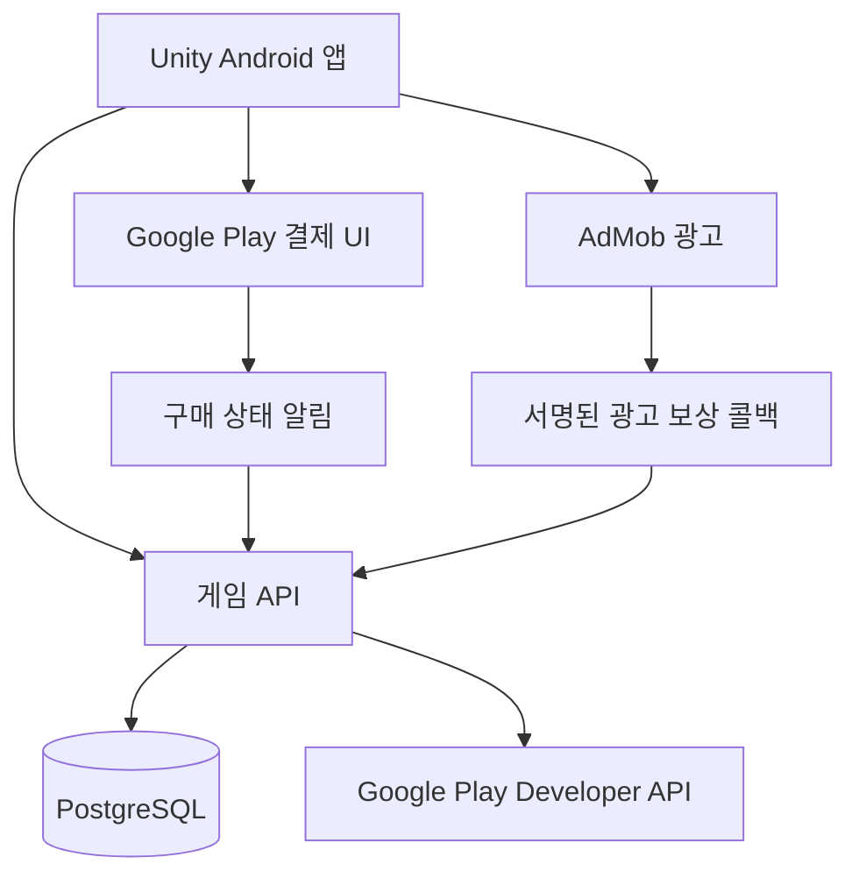

# 서버와 안드로이드 출시 계획

전투는 기기에서 실행하고 계정·재화·아이템·출석·결제 권리는 서버가 확정한다. 초기에는 단일 API 서버와 관계형 데이터베이스로 구성해 운영 복잡도를 줄인다. 게임 서버 전체를 실시간 전투 서버로 만들 필요는 없지만, 클라이언트가 보낸 보상 금액을 그대로 저장하지 않는다.

## 기술 구성 제안

| 영역 | 선택 후보 | 목적 |
| --- | --- | --- |
| 클라이언트 | Unity 6.3 LTS 계열, C# 2D | 모바일 전투, UI, 이펙트 |
| 결제 | Unity IAP와 Google Play Billing | 보석·영구 권리 구매 |
| 광고 | Google Mobile Ads Unity SDK, AdMob | 선택형 보상 광고 |
| 서버 | ASP.NET Core 10 단일 애플리케이션 (0.2 구현) | 인증, 경제, 결제, 운영 API |
| DB | SQLite WAL (0.2 구현), 운영 확장 시 PostgreSQL 검토 | 거래 원장, 인벤토리, 권리, 중복 방지 |
| 인증 | 게스트 시작 후 Google 계정 연동 | 빠른 진입과 계정 복구 |
| 운영 | 컨테이너 배포, HTTPS, DB 백업, 오류·경제 이벤트 수집 | 작은 규모에서 시작 |

Unity는 6.3 LTS 지원을 안내하고 있다. 인접한 기존 `mobilegame` 저장소에서도 Unity `6000.3.7f1`, Unity IAP `5.4.4`, Google Mobile Ads `11.5.0` 사용을 확인했다. 이를 호환성 검토의 출발점으로만 사용하며, 새 프로젝트 패치와 SDK 버전은 Android 빌드 검증 후 고정한다. [Unity 지원 안내](https://unity.com/releases/unity-6/support)

현재 `mobilegame2` 0.2에는 로컬 체험과 별도의 ASP.NET Core + SQLite 서버 계정이 구현되어 있다. Spring Boot 초기 제안 대신 Unity와 경제·전투 C# 코드를 공유하는 구성을 선택했다. 이 문서의 결제·광고·운영 확장 부분은 후속 대상이며, 실제 API와 구현 범위는 [0.2 문서](05-showcase-and-server.md)를 기준으로 한다. 프로토타입 패키지명은 `com.scrapguard.mobilegame2.prototype`이고 개발 빌드 서명을 사용한다. 기존 게임의 계정, 상품 ID, 광고 ID와 패키지명은 신규 앱에서 재사용하지 않는다. 운영 패키지명과 업로드 서명 키는 출시 작업에서 별도로 확정한다.

## 클라이언트 모듈

`Combat`는 이동·투사체·적·스킬·웨이브·승패, `Progression`은 캐릭터·장비 표시, `Economy`는 서버 거래 요청, `Commerce`는 결제와 광고 어댑터, `UI`는 화면과 상태 표현을 담당한다. `Data`에는 정의 파일과 서버 설정의 읽기 모델을 둔다.

장비·스킬·상품의 ID는 명칭 변경에도 유지한다. 에디터 제작용 데이터는 ScriptableObject로 표현할 수 있지만 서버 경제 설정은 버전이 있는 JSON/DB 설정으로 별도 확정한다. 구매·전투 시작 시 설정 버전을 기록해 진행 중인 결과가 업데이트에 따라 바뀌지 않게 한다.

적과 투사체는 풀링하고 물리 충돌·탐색 빈도를 제한한다. 1차 목표는 중급 Android 실기기에서 적 300개와 투사체 200개 상황에 30fps 유지, 상위 기기에서 선택적으로 60fps다. 이는 달성 전 성능 목표이며 프로파일링 결과에 따라 동시 개체 수를 조정한다.

## 주요 데이터

| 데이터 | 주요 필드와 제약 |
| --- | --- |
| Player | playerId, authSubject, createdAt, accountState |
| Wallet | playerId, gold, gemsPaid, gemsFree, parts, version |
| Ledger | transactionId, playerId, currency, delta, sourceType, sourceId, balanceAfter |
| InventoryItem | itemInstanceId, playerId, definitionId, rarity, level, locked, equippedSlot |
| Character | playerId와 characterId 유일, level, unlockedAt, unlockSource |
| Attendance | playerId, serviceDate, cycle, dayIndex; playerId와 serviceDate 유일 |
| ShopPurchase | playerId, offerId, serviceDate 또는 lifetimeKey, quantity |
| BattleSession | sessionId, playerId, stageId, configVersion, seed, loadoutSnapshot, state, reward |
| Purchase | purchaseToken 유일, playerId, productId, state, grantTransactionId, finalizeState |
| Entitlement | playerId, entitlementType, sourcePurchaseToken, active |
| AdClaim | claimId, playerId, placement, serviceDate, battleId, state, expiresAt |
| AdEvent | transactionId 유일, claimId, verificationState |
| Outbox | eventId, type, payload, retryAt, processedAt |

일반 경제 거래는 잔액 차감·원장 추가·아이템 지급·한도 증가·응답 저장을 한 DB 트랜잭션으로 묶는다. 같은 요청은 같은 결과를 반환하고 원장을 다시 쓰지 않는다. 잔액과 한도 행의 동시성 제어를 적용해 두 기기에서 동시에 구매해도 초과 지출을 막는다.

운영자의 보상 지급도 원장과 사유를 남긴다. 결제 토큰과 인증 정보는 로그에서 가리고, Google 서비스 계정 키는 앱에 넣지 않는다. 관리자 UI 전체는 후순위지만 상품 판매 중지·보상 조회·감사 기록은 출시 전에 확보한다.

## API 초안 (출시 확장용)

0.2 구현은 일반 거래를 `POST /v1/commands` 하나로 묶고 본문의 `requestId`·`revision`으로 중복·동시 변경을 검사한다. 아래의 개별 거래 경로와 `Idempotency-Key` 헤더는 초기 설계 초안이며 현재 제공되는 경로가 아니다. 결제·광고 엔드포인트는 아직 없다.

| API | 역할 |
| --- | --- |
| `GET /v1/bootstrap` | 서버 시각, 서비스 일자, 재화, 장비, 권리, 설정 버전 |
| `POST /v1/attendance/claim` | 오늘 출석 보상 단일 지급 |
| `POST /v1/missions/{id}/claim` | 검증된 진행도의 임무 보상 수령 |
| `POST /v1/shop/purchase` | offerId와 수량으로 서버 가격에 구매 |
| `POST /v1/inventory/sell` | 소유권·잠금·장착·강화 상태 확인 후 판매 |
| `POST /v1/equipment/upgrade` | 장비 강화와 비용 차감 |
| `POST /v1/equipment/transfer` | 원본과 대상 사이 강화 단계 이전 |
| `POST /v1/characters/{id}/upgrade` | 캐릭터 레벨 강화 |
| `POST /v1/battles/start` | 서버 시드, 장비 스냅샷, 세션 발급 |
| `POST /v1/battles/{id}/finish` | 진행 검증, 단일 보상 지급 |
| `POST /v1/billing/google/verify` | purchaseToken 검증과 지급 |
| `POST /v1/ads/claims` | 한도를 예약한 광고 보상 요청 발급 |
| `POST /v1/ads/claims/{id}/skip` | 영구 권리 확인 후 광고 없이 수령 |
| `GET /v1/ads/claims/{id}` | 광고 보상 확인 상태 조회 |
| `GET /v1/ads/ssv` | AdMob 서명 콜백 검증과 수령 확정 |
| `POST /v1/billing/google/notifications` | Google 알림 수신 후 구매 상태 재조회 |

인증 사용자로 playerId를 결정하며 요청 본문의 가격·보상 수량·서비스 일자는 신뢰하지 않는다. 상태 변경 요청은 `Idempotency-Key`를 받고 사용자·경로·요청 해시와 함께 저장한다. 동일 키로 다른 요청이 오면 충돌로 거절한다. 출석·구매 토큰·전투 결과처럼 업무상 유일해야 하는 값에는 별도 DB 제약을 둔다.

## 구매 처리와 복구

1. 결제 전에 게스트 계정을 Google 계정에 연동하도록 안내하고, 서버 playerId와 구매를 연결한다. Google 결제 계정과 게임 계정이 다를 수 있으므로 단순 이메일 일치로 소유권을 판단하지 않는다.
2. 앱은 Play 상품 정보의 가격을 표시하고 결제 UI를 실행한다. 서버는 `purchaseToken`을 받아 Google API에서 앱·상품·구매 상태·수량과 계정 연결을 확인한다. 구매 흐름에 난독화된 계정 ID를 넣고 검증한다.
3. `PENDING`에는 보상을 지급하지 않는다. `PURCHASED`이며 아직 처리하지 않은 토큰만 처리한다. 초기 상품은 수량 1만 허용한다.
4. 구매 행, 보석 원장 또는 영구 권리, 후속 처리 Outbox를 한 트랜잭션으로 기록한다. 다른 게임 계정에서 이미 사용한 토큰은 재지급하지 않는다.
5. 지급 확정 후 소모성 상품은 서버에서 consume, 영구 상품은 acknowledge 한다. Unity IAP 측 확인과 서버 처리를 한 상태 머신으로 맞추고 두 경로가 독립 지급하지 않게 한다.
6. 외부 API 실패 시 Outbox 작업을 재시도한다. 앱 종료·통신 실패·중복 콜백 후에도 이미 지급한 결과를 반환한다. 구매 권한 지급 후 신속히 확인하며, 미확인 구매가 3일 후 자동 환불되는 문제를 방지한다. [Google 구매 검증 지침](https://developer.android.com/google/play/billing/security)

첫 복구 동작은 서버 잔액과 권리를 조회하고 Play의 미처리·비소모성 구매를 재검증하는 것이다. 이미 소비된 보석 구매는 Play 조회만으로 복원할 수 있다고 가정하지 않고 서버 원장으로 복구한다. 계정 충돌 시 자동 잔액 합산 없이 소유권을 확인한다.

구매 상태 알림은 알림 자체만으로 재화를 변경하지 않고 Google API를 다시 조회하는 계기로 사용한다. 누락은 주기적 상태 확인과 무효 구매 조회로 보완한다. 환불·취소된 영구 상품은 권리를 회수한다. 보석은 원지급 기록에 연결한 보정 원장을 남기고, 이미 소비된 부분은 별도 회수 대기 값과 CS 검토로 처리한다. 중복 이벤트로 두 번 회수하지 않는다.

## 출석과 광고 처리

서비스 일자는 서버의 Asia/Seoul 시각에서 5시간을 뺀 날짜로 계산한다. 글로벌 출시에서도 처음에는 같은 초기화 기준을 유지하고 화면에 명시한다. 기기 시간 변경이나 앱 재설치로 출석을 다시 받을 수 없어야 한다.

광고 요청에는 서버가 발급한 claimId를 `custom_data`로 전달한다. 광고 서명·광고 단위·보상 종류·요청 소유자·유효 기간을 검증하고 AdMob transactionId와 claimId 각각의 중복을 막는다. 광고 시작 전 일일 횟수를 예약하고 실패·취소·만료 시 해제하되, 늦게 온 콜백과의 경합을 상태 전이로 처리한다.

추가 보상은 서명된 서버 콜백을 확인한 후 지급한다. 일시적인 지연은 수령 내역에서 확인할 수 있게 한다. 광고 스킵도 같은 claim을 소비하므로 광고 완료 콜백과 스킵이 동시에 도착해도 한 번만 지급한다. 실제로 광고를 보지 않은 스킵을 광고 노출·시청 이벤트로 보내지 않는다. [AdMob 서버 보상 검증](https://developers.google.com/admob/unity/ssv)

## 전투 신뢰 범위와 네트워크

보석 결제, 출석, 상점, 강화, 보상 확정에는 온라인 연결이 필요하다. 전투 중 짧은 단절은 허용하되 시작과 종료 시 서버가 필요하다. 전투 세션은 계정당 하나만 활성화한다. 서버는 장비·캐릭터 스냅샷, 경과 시간, 허용 스테이지, 웨이브·처치 상한과 보상표를 검증한다.

종료 결과를 로컬 대기열에 저장해 재전송할 수 있지만 그것만으로 보상을 확정하지 않는다. 이미 확정된 sessionId는 같은 결과를 반환한다. 오프라인 전투를 허용한 뒤 보석을 로컬에서 늘리는 방식은 쓰지 않는다.

0.2에서는 30Hz 이동 입력과 스킬 선택을 기록해 서버의 동일 C# 전투 로직으로 재현한다. 서버 시드·시작 당시 장비·실제 경과 시간으로 검증하며 앱이 주장한 처치·승리·보상 수치는 사용하지 않는다. 입력 재현은 봇이나 수정 앱의 합법 입력 생성까지 차단하지 않는다. 경쟁 순위 없이 PvE로 시작하며, 공개 운영 전 설정 버전 고정, 장기 전투 CPU 비용, 기기별 결정성, 이상 징후 검증이 필요하다.

## 개발 순서와 완료 기준

아래는 숙련 개발자 1명과 사용 가능한 아트 리소스를 전제로 한 8~12주 초기 추정이다. 신규 원화·애니메이션 제작, 심사, 테스트 참가자 확보 시간은 별도이며 첫 프로토타입 후 다시 산정한다.

| 단계 | 예상 작업량 | 완료 기준 |
| --- | --- | --- |
| 1 전투 프로토타입 | 1~2주 | 실기기에서 한 판 완주, 스킬 3개 이상의 선택 차이 확인 |
| 2 성장과 상점 | 2주 | 장비 강화·판매·출석·임무가 서버 재접속 후 유지 |
| 3 결제와 광고 | 1~2주 | 테스트 구매·대기·환불·복원, 중복 광고 콜백 통과 |
| 4 콘텐츠와 밸런스 | 2~3주 | 캐릭터 3종·스테이지 5개, 첫 7일 성장 검증 |
| 5 출시 품질 | 2~3주 | 성능·계정 삭제·스토어 문구·배포·복구 절차 확인 |

먼저 한 맵에서 전투와 장비 강화의 반복이 재미있는지 확인한다. 이 단계의 판단이 나오기 전에는 시즌 패스나 대규모 콘텐츠 제작을 진행하지 않는다.

## 반드시 검증할 상황

| 영역 | 검증할 상황 |
| --- | --- |
| 경제 | 두 기기 동시 구매, 잔액 부족, 같은 판매 요청 재전송, 장착·잠금 장비 판매, 강화 이전 중 실패 |
| 출석 | 오전 4시 59분과 5시 경계, 결석, 7일차 반복 보상, 기기 시간 변경 |
| 결제 | 취소, PENDING 후 PURCHASED, 지급 직후 서버 장애, acknowledge 재시도, 토큰 재사용, 다른 계정 복원, 환불 중복 통지 |
| 광고 | 광고 없음, 취소, 지연·중복 SSV, 잘못된 서명, 일일 한도, 자정 대신 오전 5시 초기화, 스킵과 콜백 경합 |
| 전투 | 종료 재전송, 설정 업데이트 중 종료, 비정상 속도·보상, 앱 종료, 통신 단절 |
| 기기 | 저·중·고사양 실기기, 긴 플레이 발열, 메모리, 화면 비율·노치, 백그라운드 복귀 |

## Google Play 출시 조건

정책 확인 기준일은 2026년 11월 2일이며 실제 제출 직전에 다시 확인한다.

- 일반 Android 신규 앱은 현재 Android 16 API 36 이상을 대상으로 제출한다. [Target API 요구사항](https://support.google.com/googleplay/android-developer/answer/11926878?hl=en)
- Play Billing 7의 연장 기한은 2026년 11월 1일까지다. 새 빌드는 Billing 8 이상을 포함하는 SDK 조합을 사용하고 Gradle 결과에서 실제 포함 버전을 확인한다. [결제 라이브러리 지원 일정](https://developer.android.com/google/play/billing/deprecation-faq)
- AAB와 ARM64 빌드를 준비하고 Unity 및 광고 SDK의 네이티브 라이브러리를 포함해 16KB 페이지 환경을 검증한다. [Android 16KB 호환 안내](https://developer.android.com/guide/practices/page-sizes)
- 2023년 11월 13일 이후 생성한 개인 개발자 계정에 해당하면 최소 12명이 14일 연속 참여한 비공개 테스트 후 프로덕션 액세스를 신청해야 한다. 해당 조건 충족이 자동 출시 승인을 뜻하지는 않는다. [개인 계정 테스트 요구사항](https://support.google.com/googleplay/android-developer/answer/14151465?hl=en)
- 계정 생성 기능에 맞춰 앱 내 계정 삭제 경로와 웹 삭제 요청 경로를 준비한다. [Google Play 계정 삭제 요구사항](https://support.google.com/googleplay/android-developer/answer/13327111?hl=en-EN)

출시 작업에는 개인정보처리방침, SDK별 수집 데이터에 맞춘 Data safety, 광고 포함 표시, 실제 콘텐츠에 맞는 연령·콘텐츠 등급, 고객지원 연락처, 스크린샷과 아이콘을 포함한다. 초기 타깃은 일반 이용자로 두되 아트만으로 연령 분류를 단정하지 않는다. 배포 국가와 타깃 연령에 맞는 광고 동의 설정도 SDK 통합 때 확정한다.

개발 중에는 광고 테스트 ID와 Play 테스트 구매를 사용한다. 운영 계정 설정과 상품 등록, AAB 업로드, 실제 출시 전환은 개발 단계와 분리해서 진행한다.

## 이후 확정할 제품 선택

기본안은 직접 이동하는 생존 전투, 로봇·정비사 소재, NPC 매입 상점, 한국어와 국내 우선 테스트다. 완전 방치형 여부, 아트 방향과 최종 이름, 개발 인원·제작 예산, 출시 국가, 기존 Play 계정의 테스트 요건 적용 여부는 다음 단계에서 구체화한다. 설계만으로 실제 상품이나 운영 서비스가 생성되지는 않는다.
